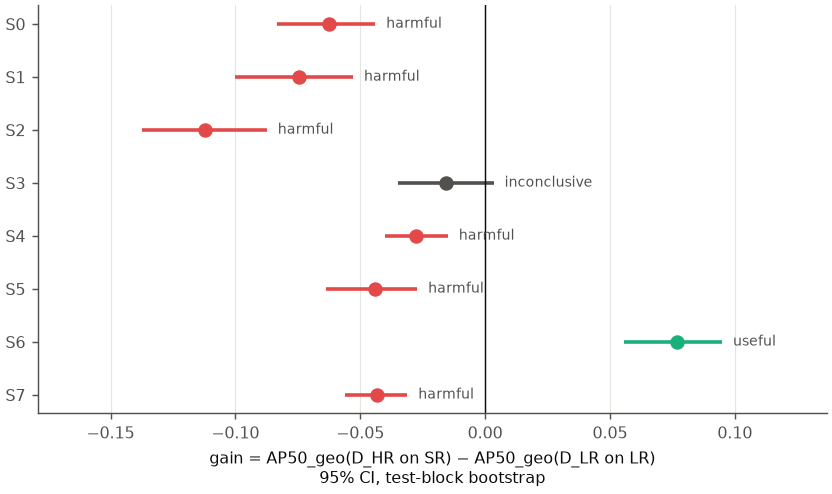
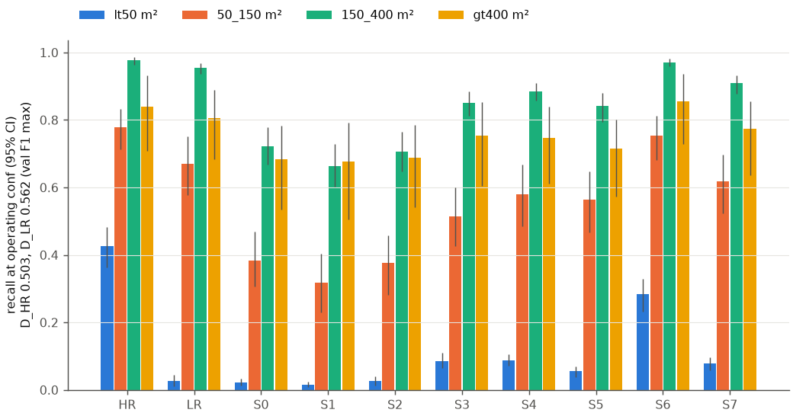
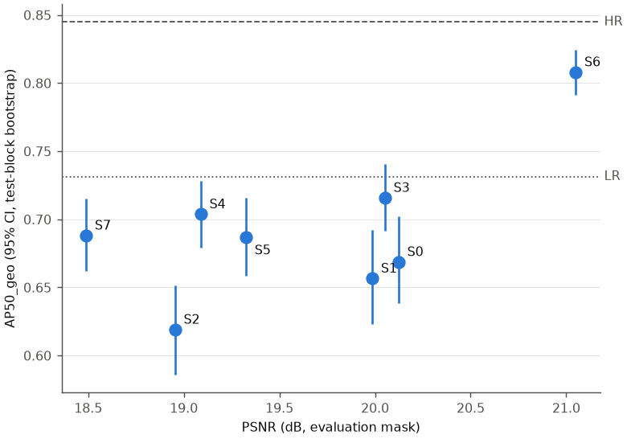
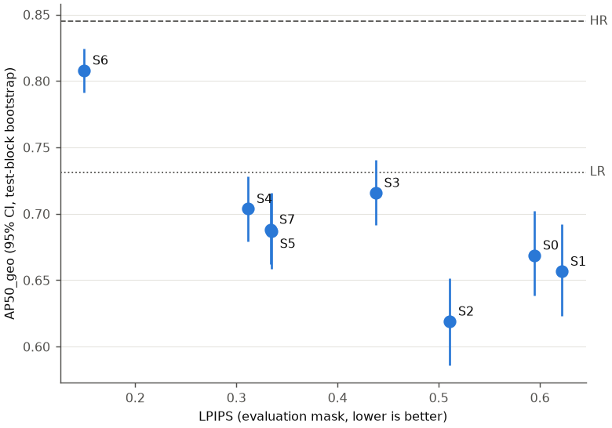
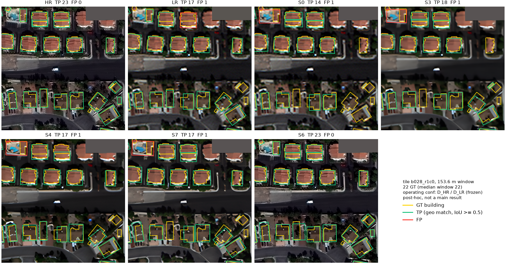
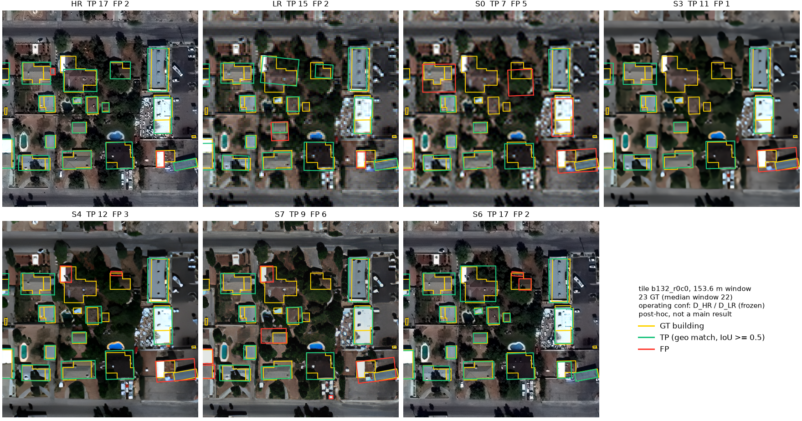
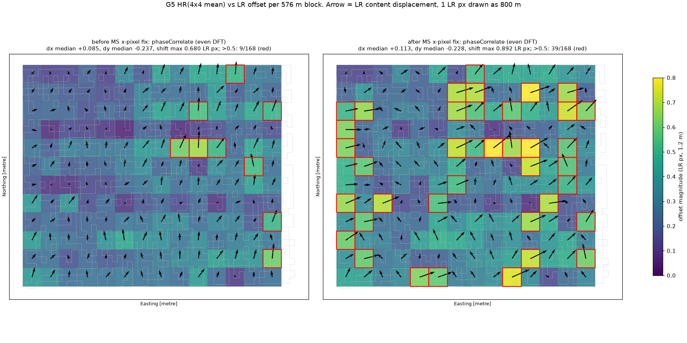

# rs-sr-detect: 실제 멀티스펙트럼 영상을 ×4 초해상도로 올리면 고정된 건물 탐지기에 도움이 되는가?

English: [README.md](README.md)

**결론부터: 실제 센서 쌍으로 파인튜닝한 SR만 도움이 됐다.** 실제 1.2 m WorldView-3 멀티스펙트럼 영상에 초해상도(SR) 여덟 가지를 적용하고, PSNR이 아니라 건물 탐지 정확도로 판정했다. HR로 학습해 고정한 탐지기 기준으로, SpaceNet MS–PS 쌍으로 파인튜닝한 Real-ESRGAN만 저해상도 영상을 그대로 탐지하는 것보다 나았다. 확산 모델 두 가지를 포함한 공개 SR 모델은 모두 해롭거나 판단 불가였다.

이 저장소는 한 가지 상황을 대신 재현하는 대리 실험이다. PAN 밴드 없이 1.2 m급 영상만 있고(다른 위성이거나 PAN이 제공되지 않은 자료), 이를 0.3 m급으로 올려야 하는 상황이다. SpaceNet 2(AOI_2_Vegas)는 같은 WorldView-3 촬영에서 나온 두 제품을 함께 제공한다. 실제 1.2 m 멀티스펙트럼(MS) GeoTIFF를 저해상도(LR) 입력으로, 0.3 m 팬샤프닝 RGB(PS-RGB)를 고해상도(HR) 정답으로 쓴다. 합성 열화는 쓰지 않고, 배율은 ×4 하나다.

## 결과 한눈에 보기

| 탐지기 입력 | AP50_geo [95% CI] | LR 대비 gain [95% CI] | 판정 |
| --- | --- | --- | --- |
| 실제 HR, 0.3 m (상한) | 0.845 [0.828, 0.861] | – | – |
| **실제 MS–PS 쌍으로 파인튜닝한 SR (S6)** | **0.808 [0.791, 0.825]** | **+0.077 [+0.056, +0.095]** | **useful**, 격차의 68% 회복 |
| LR 그대로, 1.2 m (경로 1 기준선) | 0.731 [0.710, 0.754] | – | – |
| 공개 SR 최고: Real-ESRNet (S3) | 0.716 [0.692, 0.741] | -0.015 [-0.035, +0.003] | inconclusive |
| 원스텝 확산: OSEDiff (S7) | 0.688 [0.662, 0.715] | -0.043 [-0.056, -0.031] | harmful |
| Bicubic 보간 (S0) | 0.669 [0.639, 0.702] | -0.063 [-0.083, -0.044] | harmful |

- **SR이 효과를 내는 곳은 작은 건물이다.** 50 m² 미만 건물의 재현율이 LR 0.027에서 S6 0.283으로 올랐다. 공개 SR 모델은 0.088 이하에 머물렀고, LR 탐지기가 이미 잘 찾던 50–400 m² 주택에서는 오히려 재현율을 잃었다.
- **PSNR은 유용성을 예측하지 못했다.** PSNR 순위와 탐지 순위의 Spearman 상관은 0.381(p 0.352, n=8)이고, S6를 빼면 0.071이다.
- **생성형 SR은 없는 건물을 만든다.** OSEDiff의 거짓 양성 비율이 0.204로 가장 높았다. 실제 HR은 0.139다.

모든 수치는 [results/summary.csv](results/summary.csv)와 [results/posthoc/](results/posthoc)에서 나왔다. 이 데이터(도시 한 곳, 촬영 한 번)와 "HR로 학습해 고정한 탐지기" 조건에서만 성립한다.

## 무엇을 했나

- **합성 축소가 아닌 실제 센서 쌍.** LR 입력은 1.2 m 멀티스펙트럼 제품이고, 기준은 같은 WorldView-3 촬영의 0.3 m 팬샤프닝 제품이다(SpaceNet 2 라스베이거스, 칩 1,168장).
- **좌표를 유지하는 GDAL·OpenCV 파이프라인.** 두 제품을 LR 1화소가 HR 4×4화소에 정확히 대응하는 UTM 격자 하나로 맞췄다. 타일 예측은 지도 좌표에서 병합하고 그 자리에서 건물 footprint와 매칭했다.
- **5계열 SR 8종**(보간, 회귀, GAN, 확산, 도메인 파인튜닝)을 하나의 고정 YOLO26s-OBB 탐지기에 넣고, LR로 직접 학습한 탐지기와 비교했다.
- **미리 정한 판정 규칙.** AP50 gain의 공간 블록 부트스트랩 CI로 useful, harmful, inconclusive를 정했다. 모든 임계값은 val에서 정해 test를 한 번 돌리기 전에 고정했다([docs/frozen_eval.md](docs/frozen_eval.md)).

<details>
<summary><b>파인튜닝한 SR 모델(S6)을 어떻게 학습했고, 파인튜닝 전과 비교하면 어떤가</b></summary>

S6는 이 프로젝트에서 실제 영상 쌍으로 파인튜닝한 Real-ESRGAN이다. S4와 같은 공개 가중치에서 출발하므로 S6 − S4가 파인튜닝 효과다. 출처: [results/s6_finetune.json](results/s6_finetune.json), [results/S6_realesrgan_ft_spacenet.yml](results/S6_realesrgan_ft_spacenet.yml), [docs/decisions.md](docs/decisions.md).

| 항목 | 설정 |
| --- | --- |
| 시작 가중치 | 공식 RealESRGAN_x4plus(생성기)와 RealESRGAN_x4plus_netD(U-Net 판별기) |
| 학습 방식 | Real-ESRGAN 공식 paired-data 파인튜닝 설정에 가중치 경로, 데이터 경로, 반복 수, milestones를 이 실험에 맞게 지정 |
| 학습 데이터 | train 블록 타일 쌍 433개: 실제 멀티스펙트럼 1.2 m(LR)와 같은 위치의 팬샤프닝 0.3 m(HR) |
| 손실 | L1 픽셀 손실, 지각(perceptual) 손실, GAN 손실 |
| 최적화 | Adam, 학습률 1e-4, 배치 12, HR 256 px 무작위 크롭 |
| 반복 수 | 공식 400,000회 중 23,600회(5.9%). 반복당 0.4117 s를 실측해 3 h × 0.9 안에 맞춤 |
| 시간 | RTX 4090 한 장에서 9,481 s |
| 체크포인트 | 마지막 것. 시작 대비 가중치 최대 변화가 0.237로, 학습이 실제로 모델을 바꿨음 |
| 누출 방지 | train 블록으로만 학습하고, 공간적으로 분리된 test 블록에서 평가 |

| 지표 (test 블록) | S4, 공개 가중치 | S6, 파인튜닝 |
| --- | --- | --- |
| PSNR | 19.09 | 21.05 |
| SSIM | 0.549 | 0.637 |
| LPIPS (낮을수록 좋음) | 0.312 | 0.149 |
| AP50_geo [95% CI] | 0.704 [0.679, 0.728] | 0.808 [0.791, 0.825] |
| 50 m² 미만 건물 재현율 | 0.088 | 0.283 |
| 거짓 양성 비율 | 0.172 | 0.147 |

두 AP50_geo 신뢰구간은 겹치지 않는다. 이 비교는 HR로 학습해 고정한 탐지기 조건에서 성립한다.

</details>

## 진행 중 풀어야 했던 문제

- **데이터에 구멍이 있었다.** SpaceNet은 train·test 칩을 섞어 배치해 라벨이 이어진 영역이 없다. 칩 footprint로 유효 마스크를 만들고, 빈칸은 중립색으로 채우고, 경계 9.6 m는 평가에서 뺐다. 제외 폭 0, 8, 16 LR px 모두에서 방법 순위가 같았다.
- **데이터보다 정합 검사가 먼저 틀려 있었다.** 처음에는 168개 블록 중 110개가 정합 기준을 넘었다. 합성 이동 실험으로 OpenCV `phaseCorrelate`가 홀수 크기에서 정확히 +0.5 px 편향됨을 찾았다. 측정을 고친 뒤 남은 오차는 650 / 4 = 162.5 px 칩 위상 문제로 밝혀졌고, 칩별 맞춤이 아닌 기하 규칙으로 정정했다.
- **약한 기준선은 모든 이득을 부풀린다.** LR 탐지기가 덜 학습됐는지를 미리 적어 둔 기준으로 검사했다. 기준을 넘어서 두 탐지기를 200에폭으로 다시 학습했다.

자세히: [방법](#방법) · [주요 결과](#주요-결과) · [사후 분석](#사후-분석-사후-분석-주-결론-아님) · [엔지니어링 발견](#엔지니어링-발견) · [한계](#한계) · [재현](#재현)

## 질문과 동기

SR 논문은 보통 PSNR, SSIM, LPIPS로 모델 순위를 매긴다. 하지만 실제로 결과를 쓰는 사람의 질문은 다르다. 기존 분석 모델 앞에 SR을 넣으면 원본 자료로 바로 분석할 때보다 더 나은 지도가 나오는가? 이 실험은 회전 건물 탐지라는 한 과제에서 이 질문에 답한다. 주 지표는 타일을 병합한 뒤 지리 좌표에서 계산한 AP50(AP50_geo)이다. 화질 지표는 탐지 결과를 설명하는 데만 쓴다.

- **Shermeyer & Van Etten 2019**([arXiv:1812.04098](https://arxiv.org/abs/1812.04098), EarthVision)는 위성 영상을 VDSR과 랜덤 포레스트 방법으로 ×2, ×4, ×8 초해상도한 뒤 객체 탐지 성능을 쟀다. 30 cm에서 15 cm로 올릴 때 이득이 가장 컸고, 해상도가 거칠수록 이득이 작았다. 이 연구는 해상도별 영상과 SR 출력마다 탐지기를 학습했다. 이 실험은 세 가지가 다르다. LR 입력이 리샘플한 영상이 아니라 실제 센서 제품이고, 탐지기는 HR로 한 번만 학습해 고정하며, 대상은 건물이다.
- **GeoSR-Bench**([arXiv:2605.00310](https://arxiv.org/abs/2605.00310))는 같은 위치를 여러 플랫폼이 촬영한 영상 쌍에서 SR 모델 9개를 비교한다. 지각 화질과 함께 다운스트림 과제(토지피복 분할, 기반시설 지도화, 생물물리 변수 추정)를 평가하며, 충실도 지표의 향상이 다운스트림 과제로 이어지지 않는 경우가 많다고 보고한다. 이 저장소는 같은 문제의식을 가진 더 작은 단일 장면 사례 연구다. 도시 하나, 센서 쌍 하나, 과제 하나를 다루고, 블록 단위 bootstrap 신뢰구간과 test 평가 전에 고정한 설정을 쓴다.

## 데이터와 설정

- **출처:** SpaceNet 2, AOI_2_Vegas의 train 분할(`s3://spacenet-dataset/spacenet/SN2_buildings/train/AOI_2_Vegas/`). 칩 1,168장의 PS-RGB, MS, 건물 GeoJSON만 받았다. 자세한 내용은 [docs/data_report.md](docs/data_report.md)에 있다.
- **LR 입력:** MS 밴드 5, 3, 2(WorldView-3 8밴드 순서에서 Red, Green, Blue)를 1.2 m UTM 격자(EPSG:32611)로 워프했다. 밴드 선택은 PS-RGB를 MS 격자로 평균 축소해 MS 밴드별 상관을 재서 확인했다.
- **HR 정답:** PS-RGB를 0.3 m 격자로 워프했다. LR 1화소가 HR 4×4화소에 정확히 대응하도록 격자를 맞췄다(assert로 확인). **PS-RGB는 같은 촬영의 PAN과 MS를 합친 팬샤프닝 산출물이며**, 독립적으로 측정한 0.3 m 영상이 아니다.
- **8비트 변환:** 제품마다 밴드별 2–98 백분위 스트레치를 따로 적용했고, 백분위는 train 블록에서만 계산했다.
- **공간 분할:** 576 m 블록(LR 480 px)을 건물 수 기준으로 train / val / test에 배정했다. 결과는 118 / 26 / 24블록, 건물 23,394 / 5,020 / 5,194개다. 타일은 307.2 m(HR 1024 px, LR 256 px)이고 블록당 2×2이며, 블록 경계를 넘지 않는다.
- **NoData와 평가 영역:** SpaceNet은 train 칩과 test 칩이 공간적으로 섞여 있어, 받은 창 안에 빈칸이 있다. 유효 마스크는 픽셀값이 아니라 칩 footprint 합집합으로 만든다. 무효 화소는 train 블록 평균색으로 채우고, 모든 SR 출력도 같은 값으로 다시 덮는다. 평가 영역은 footprint를 안쪽으로 9.6 m(8 LR px) 줄인 영역이다. 면적의 50% 이상이 이 영역 밖인 정답과 예측은 TP, FP, FN에서 모두 뺀다. 제외 폭 0 / 8 / 16 LR px 민감도는 아래에 싣는다.

## 방법

- **경로 1(하한):** LR 타일로 학습한 YOLO26s-OBB인 D_LR(imgsz 256)로 LR을 탐지한다.
- **경로 2:** 같은 구조를 HR 타일로 학습한 D_HR(imgsz 1024)로 각 SR 출력을 탐지한다. SR 방법마다 D_HR을 다시 학습하지 않는다. 그래서 모든 결론에는 "HR로 학습해 고정한 탐지기를 쓸 때"라는 조건이 붙는다.
- **상한:** D_HR로 HR을 탐지한다.
- **SR 방법(×4, 입력은 모두 같은 8비트 LR 타일):**

  | ID | 범주 | 방법 |
  |---|---|---|
  | S0 / S1 | 보간 | GDAL cubic / lanczos |
  | S2 | 회귀 | SwinIR classical ×4 (DF2K) |
  | S3 | 회귀 | Real-ESRNet x4plus |
  | S4 | GAN | Real-ESRGAN x4plus |
  | S5 | Diffusion(효율형) | ResShift v3 |
  | S6 | 도메인 파인튜닝 | train 블록 MS–PS 쌍으로 파인튜닝한 Real-ESRGAN |
  | S7 | 단일 스텝 Diffusion | OSEDiff |

  S6는 공식 paired data 파인튜닝 설정으로 RealESRGAN_x4plus에서 시작했다. 반복 횟수는 23,600회로, 실측 반복당 0.4117 s와 3시간 예산으로 정했다. 따라서 S6 − S4가 파인튜닝 효과다.
- **병합과 매칭:** 타일 예측은 블록마다 `cv2.dnn.NMSBoxesRotated`(IoU 0.5)로 병합한다. 그다음 UTM에서 정답(각 건물 폴리곤의 최소 회전 사각형)과 회전 IoU ≥ 0.5로 매칭한다.
- **지표:** AP50_geo는 conf ≥ 0.001, max_det 3000인 예측으로 계산한다. 면적 구간별 재현율과 거짓 양성(FP) 수는 val에서 F1이 최대인 운영 conf를 쓴다. D_HR은 0.503(모든 SR 행에도 적용), D_LR은 0.562다.
- **판정:** 95% 신뢰구간은 test 블록 bootstrap(블록을 복원추출하는 재표본, 1,000회, seed 0)으로 구한다. gain = AP50_geo(경로 2) − AP50_geo(경로 1)이고, 같은 재표본에서 계산한다. gain 신뢰구간 하한이 0보다 크면 **useful**, 상한이 0보다 작으면 **harmful**, 그 밖에는 **inconclusive**다. recovery = gain / (AP50_geo(HR) − AP50_geo(LR)).
- **test 전 설정 고정:** 탐지기 가중치(SHA256), max_det, 병합 IoU, 운영 conf, 제외 폭, Canny 임계값, 코드 커밋은 test 블록을 평가하기 전에 [docs/frozen_eval.md](docs/frozen_eval.md)에 기록했다. 모든 값은 train 또는 val 블록에서 정했다. 이후의 사후 분석 재실행도 같은 파일에 기록했다.
- **200에폭 결정(사전에 고정한 기준):** 처음 학습한 D_LR은 조기 종료 없이 기본값 100에폭 상한까지 돌았다. 그래서 200에폭 D_LR을 따로 학습하고, 결과를 보기 전에 기준을 정했다. LR val AP50_geo가 0.01 이상 오르면 두 탐지기를 모두 200에폭으로 다시 학습한다는 기준이다. 결과는 0.6619에서 0.6743으로 +0.0124 올랐고, 기준대로 두 탐지기를 epochs 200, patience 20으로 다시 학습했다. D_HR은 86에폭에서 조기 종료했고 D_LR은 200에폭을 모두 돌았다. 최적 가중치는 val에서 Ultralytics 기본 fitness인 mAP50-95로 골랐다([docs/decisions.md](docs/decisions.md)).

## 주요 결과

test 블록, 평가 영역 안 정답 건물 4,426개, 제외 폭 8 LR px. 출처: [results/summary.csv](results/summary.csv).

<!-- BEGIN:main -->
| method | path | AP50_geo [95% CI] | gain vs LR [95% CI] | recovery | verdict | FP |
|---|---|---|---|---|---|---|
| HR | HR (D_HR on HR) | 0.845 [0.828, 0.861] | – | – | – | 584 |
| LR | path1 (D_LR on LR) | 0.731 [0.710, 0.754] | – | – | – | 415 |
| S0_gdal_cubic | path2 (D_HR on SR) | 0.669 [0.639, 0.702] | -0.063 [-0.083, -0.044] | -0.55 | **harmful** | 290 |
| S1_gdal_lanczos | path2 (D_HR on SR) | 0.657 [0.623, 0.692] | -0.075 [-0.100, -0.053] | -0.66 | **harmful** | 268 |
| S2_swinir_classical_x4 | path2 (D_HR on SR) | 0.619 [0.586, 0.651] | -0.112 [-0.137, -0.087] | -0.99 | **harmful** | 398 |
| S3_realesrnet_x4plus | path2 (D_HR on SR) | 0.716 [0.692, 0.741] | -0.015 [-0.035, +0.003] | -0.14 | **inconclusive** | 433 |
| S4_realesrgan_x4plus | path2 (D_HR on SR) | 0.704 [0.679, 0.728] | -0.028 [-0.040, -0.015] | -0.24 | **harmful** | 599 |
| S5_resshift_v3_x4 | path2 (D_HR on SR) | 0.687 [0.658, 0.716] | -0.044 [-0.064, -0.027] | -0.39 | **harmful** | 452 |
| S6_realesrgan_ft_spacenet | path2 (D_HR on SR) | 0.808 [0.791, 0.825] | +0.077 [+0.056, +0.095] | 0.68 | **useful** | 595 |
| S7_osediff_x4 | path2 (D_HR on SR) | 0.688 [0.662, 0.715] | -0.043 [-0.056, -0.031] | -0.38 | **harmful** | 763 |
<!-- END:main -->



면적 구간별 재현율(운영 conf)과 경로 1 대비 gain 판정:

<!-- BEGIN:recall -->
| method | <50 m² | 50–150 m² | 150–400 m² | >400 m² | verdict vs LR (<50 / 50–150 / 150–400 / >400) |
|---|---|---|---|---|---|
| HR | 0.427 [0.364, 0.482] | 0.779 [0.714, 0.833] | 0.977 [0.964, 0.987] | 0.839 [0.708, 0.932] | – |
| LR | 0.027 [0.012, 0.045] | 0.670 [0.576, 0.752] | 0.955 [0.937, 0.969] | 0.806 [0.684, 0.889] | – |
| S0_gdal_cubic | 0.023 [0.012, 0.034] | 0.383 [0.306, 0.468] | 0.721 [0.667, 0.779] | 0.683 [0.535, 0.782] | inconclusive / harmful / harmful / harmful |
| S1_gdal_lanczos | 0.015 [0.007, 0.023] | 0.317 [0.230, 0.403] | 0.662 [0.601, 0.728] | 0.677 [0.504, 0.792] | inconclusive / harmful / harmful / harmful |
| S2_swinir_classical_x4 | 0.026 [0.013, 0.040] | 0.377 [0.281, 0.457] | 0.707 [0.647, 0.764] | 0.688 [0.542, 0.786] | inconclusive / harmful / harmful / harmful |
| S3_realesrnet_x4plus | 0.085 [0.065, 0.109] | 0.514 [0.426, 0.600] | 0.850 [0.813, 0.885] | 0.753 [0.604, 0.852] | useful / harmful / harmful / harmful |
| S4_realesrgan_x4plus | 0.088 [0.071, 0.105] | 0.580 [0.485, 0.667] | 0.884 [0.857, 0.909] | 0.747 [0.612, 0.840] | useful / harmful / harmful / harmful |
| S5_resshift_v3_x4 | 0.055 [0.038, 0.070] | 0.564 [0.466, 0.647] | 0.841 [0.795, 0.880] | 0.715 [0.574, 0.802] | useful / harmful / harmful / harmful |
| S6_realesrgan_ft_spacenet | 0.283 [0.232, 0.330] | 0.753 [0.682, 0.812] | 0.971 [0.958, 0.982] | 0.855 [0.729, 0.938] | useful / useful / useful / useful |
| S7_osediff_x4 | 0.078 [0.059, 0.096] | 0.618 [0.523, 0.698] | 0.908 [0.878, 0.932] | 0.774 [0.636, 0.856] | useful / harmful / harmful / inconclusive |
<!-- END:recall -->



화질 지표(평가 영역 마스크)와 처리 시간(모델 로딩 제외, 로딩 시간은 따로 표시):

<!-- BEGIN:quality -->
| method | PSNR | SSIM | LPIPS | edge_precision | edge_recall | sharpness_ratio | SR s/km² | SR load s | det s/km² |
|---|---|---|---|---|---|---|---|---|---|
| S0_gdal_cubic | 20.12 | 0.573 | 0.595 | 0.821 | 0.464 | 0.027 | 6.8 | – | 0.4 |
| S1_gdal_lanczos | 19.99 | 0.570 | 0.622 | 0.820 | 0.480 | 0.028 | 7.1 | – | 0.4 |
| S2_swinir_classical_x4 | 18.95 | 0.561 | 0.511 | 0.812 | 0.580 | 0.203 | 14.4 | 27.0 | 0.4 |
| S3_realesrnet_x4plus | 20.05 | 0.594 | 0.438 | 0.871 | 0.414 | 0.081 | 1.1 | 26.6 | 0.4 |
| S4_realesrgan_x4plus | 19.09 | 0.549 | 0.312 | 0.836 | 0.579 | 0.512 | 1.2 | 25.8 | 0.5 |
| S5_resshift_v3_x4 | 19.32 | 0.522 | 0.335 | 0.786 | 0.664 | 0.691 | 14.9 | 38.0 | 0.5 |
| S6_realesrgan_ft_spacenet | 21.05 | 0.637 | 0.149 | 0.890 | 0.805 | 0.847 | 1.2 | 29.1 | 0.5 |
| S7_osediff_x4 | 18.49 | 0.495 | 0.334 | 0.795 | 0.693 | 1.216 | 16.1 | 96.6 | 0.4 |
<!-- END:quality -->

화질 지표 순위와 AP50_geo 순위 사이의 Spearman 상관(SR 방법 8개):

<!-- BEGIN:spearman -->
| metric | Spearman ρ vs AP50_geo | p | n |
|---|---|---|---|
| PSNR | 0.381 | 0.352 | 8 |
| SSIM | 0.333 | 0.420 | 8 |
| LPIPS | 0.786 | 0.021 | 8 |
| edge_precision | 0.643 | 0.086 | 8 |
| edge_recall | 0.214 | 0.610 | 8 |
<!-- END:spearman -->

| PSNR vs AP50_geo | LPIPS vs AP50_geo |
|---|---|
|  |  |

제외 폭 민감도(평가 영역을 안쪽으로 0 / 8 / 16 LR px 줄임):

<!-- BEGIN:buffer -->
| method | 0 LR px: AP50 / gain / verdict | 8 LR px: AP50 / gain / verdict | 16 LR px: AP50 / gain / verdict |
|---|---|---|---|
| HR | 0.835 | 0.845 | 0.841 |
| LR | 0.717 | 0.731 | 0.733 |
| S0_gdal_cubic | 0.648 / -0.068 / harmful | 0.669 / -0.063 / harmful | 0.668 / -0.065 / harmful |
| S1_gdal_lanczos | 0.636 / -0.081 / harmful | 0.657 / -0.075 / harmful | 0.656 / -0.076 / harmful |
| S2_swinir_classical_x4 | 0.596 / -0.121 / harmful | 0.619 / -0.112 / harmful | 0.618 / -0.115 / harmful |
| S3_realesrnet_x4plus | 0.690 / -0.026 / harmful | 0.716 / -0.015 / inconclusive | 0.714 / -0.019 / harmful |
| S4_realesrgan_x4plus | 0.681 / -0.035 / harmful | 0.704 / -0.028 / harmful | 0.701 / -0.032 / harmful |
| S5_resshift_v3_x4 | 0.669 / -0.048 / harmful | 0.687 / -0.044 / harmful | 0.684 / -0.049 / harmful |
| S6_realesrgan_ft_spacenet | 0.796 / +0.079 / useful | 0.808 / +0.077 / useful | 0.807 / +0.074 / useful |
| S7_osediff_x4 | 0.669 / -0.048 / harmful | 0.688 / -0.043 / harmful | 0.689 / -0.044 / harmful |
<!-- END:buffer -->

HR로 학습해 고정한 탐지기를 쓸 때, 이 데이터에서 주요 결과는 다음과 같다.

- useful인 방법은 S6 하나다. AP50_geo에서도, 모든 면적 구간에서도 그렇다. 50 m² 미만 건물에서 gain은 +0.256 [+0.213, +0.298]이다.
- S3, S4, S5, S7은 50 m² 미만 건물에서만 useful이고 50–150, 150–400 m² 구간에서는 harmful이다. 전체 AP50_geo gain은 음수이거나 inconclusive다.
- 방법 순위는 제외 폭 3가지에서 모두 같다. S3는 0과 16 LR px에서 harmful, 8 LR px에서 inconclusive라서 판정이 제외 폭에 따라 달라진다.
- 시간: S6의 SR은 1.164 s/km²에 모델 로딩 29.07 s가 든다. S6 출력에 대한 D_HR 탐지(0.459 s/km²)와 같은 규모다. Diffusion 모델 S5와 S7은 14.901, 16.150 s/km²가 들고 harmful이다. [results/figures/report_e_time_vs_ap50.png](results/figures/report_e_time_vs_ap50.png)도 참고.

## 사후 분석 (사후 분석, 주 결론 아님)

아래 분석은 test 결과를 본 뒤에 요청받아 추가했다. 고정한 탐지기와 평가 설정을 그대로 쓰고, 결과는 [results/posthoc/](results/posthoc/)에 따로 저장했다. [results/summary.csv](results/summary.csv)와 위 판정은 바꾸지 않았다. 신뢰구간은 같은 블록 bootstrap 재표본으로 구했다(주 결과의 AP50과 신뢰구간이 그대로 재현되는지 확인).

**bicubic 보간(S0) 대비 이득.** 경로 1 대신 S0를 기준으로 하면 S3, S4, S6, S7은 better, S1과 S2는 worse다. S0 자체가 경로 1 대비 harmful이므로 주 판정은 바뀌지 않는다.

<!-- BEGIN:ph_s0 -->
| method | AP50_geo [95% CI] | AP50 − S0 [95% CI] | verdict |
|---|---|---|---|
| S1_gdal_lanczos | 0.657 [0.623, 0.692] | -0.012 [-0.017, -0.007] | worse |
| S2_swinir_classical_x4 | 0.619 [0.586, 0.651] | -0.050 [-0.080, -0.022] | worse |
| S3_realesrnet_x4plus | 0.716 [0.692, 0.741] | +0.047 [+0.031, +0.064] | better |
| S4_realesrgan_x4plus | 0.704 [0.679, 0.728] | +0.035 [+0.020, +0.052] | better |
| S5_resshift_v3_x4 | 0.687 [0.658, 0.716] | +0.018 [-0.004, +0.042] | inconclusive |
| S6_realesrgan_ft_spacenet | 0.808 [0.791, 0.825] | +0.139 [+0.113, +0.164] | better |
| S7_osediff_x4 | 0.688 [0.662, 0.715] | +0.019 [+0.002, +0.038] | better |
| S0_color | 0.657 [0.624, 0.692] | -0.012 [-0.019, -0.005] | worse |
| S3_color | 0.713 [0.690, 0.738] | +0.044 [+0.029, +0.061] | better |
<!-- END:ph_s0 -->

**색 보정 대조군.** LR 8비트 값을 HR 8비트 값(4×4 평균)으로 옮기는 밴드별 선형 변환(gain, offset)을 train 블록의 평가 마스크 안 화소에서 최소제곱으로 맞췄다. 이를 S0와 S3 출력에 적용해 S0_color와 S3_color를 만들었다.

<!-- BEGIN:ph_colorfit -->
| band | gain | offset | R² |
|---|---|---|---|
| R | 0.888 | 8.53 | 0.917 |
| G | 0.882 | 7.87 | 0.907 |
| B | 0.855 | 13.43 | 0.892 |
<!-- END:ph_colorfit -->

<!-- BEGIN:ph_color -->
| method | AP50_geo [95% CI] | reference | reference AP50 | difference [95% CI] | verdict |
|---|---|---|---|---|---|
| S0_color | 0.657 [0.624, 0.692] | S6_realesrgan_ft_spacenet | 0.808 | -0.151 [-0.178, -0.122] | worse |
| S0_color | 0.657 [0.624, 0.692] | LR | 0.731 | -0.075 [-0.096, -0.055] | worse |
| S0_color | 0.657 [0.624, 0.692] | S0_gdal_cubic | 0.669 | -0.012 [-0.019, -0.005] | worse |
| S3_color | 0.713 [0.690, 0.738] | S6_realesrgan_ft_spacenet | 0.808 | -0.095 [-0.114, -0.074] | worse |
| S3_color | 0.713 [0.690, 0.738] | LR | 0.731 | -0.018 [-0.037, +0.001] | inconclusive |
| S3_color | 0.713 [0.690, 0.738] | S3_realesrnet_x4plus | 0.716 | -0.003 [-0.009, +0.004] | inconclusive |
<!-- END:ph_color -->

전역 선형 색 변환은 도움이 되지 않았다. S0_color는 S0보다 나쁘고, S3_color는 S3 대비 inconclusive다. 둘 다 S6보다 각각 -0.151, -0.095 낮고 신뢰구간이 0을 포함하지 않는다. 따라서 S6의 이득은 전역 선형 색 변환으로는 설명되지 않는다(not explained by a global linear color shift). 이 대조군만으로는 S6 이득이 무엇에서 오는지 알 수 없고, 비선형이나 국소적인 색 차이는 검증하지 않았다.

**운영 conf에서 면적 구간별 재현율, 거짓 양성, 예측 수.**

<!-- BEGIN:ph_area -->
| method | conf | <50 m² | 50–150 m² | 150–400 m² | >400 m² | FP | predictions | FP ratio |
|---|---|---|---|---|---|---|---|---|
| HR | 0.503 | 0.427 [0.364, 0.482] | 0.779 [0.714, 0.833] | 0.977 [0.964, 0.987] | 0.839 [0.708, 0.932] | 584 | 4202 | 0.139 |
| LR | 0.562 | 0.027 [0.012, 0.045] | 0.670 [0.576, 0.752] | 0.955 [0.937, 0.969] | 0.806 [0.684, 0.889] | 415 | 3509 | 0.118 |
| S0_gdal_cubic | 0.503 | 0.023 [0.012, 0.034] | 0.383 [0.306, 0.468] | 0.721 [0.667, 0.779] | 0.683 [0.535, 0.782] | 290 | 2535 | 0.114 |
| S1_gdal_lanczos | 0.503 | 0.015 [0.007, 0.023] | 0.317 [0.230, 0.403] | 0.662 [0.601, 0.728] | 0.677 [0.504, 0.792] | 268 | 2303 | 0.116 |
| S2_swinir_classical_x4 | 0.503 | 0.026 [0.013, 0.040] | 0.377 [0.281, 0.457] | 0.707 [0.647, 0.764] | 0.688 [0.542, 0.786] | 398 | 2606 | 0.153 |
| S3_realesrnet_x4plus | 0.503 | 0.085 [0.065, 0.109] | 0.514 [0.426, 0.600] | 0.850 [0.813, 0.885] | 0.753 [0.604, 0.852] | 433 | 3178 | 0.136 |
| S4_realesrgan_x4plus | 0.503 | 0.088 [0.071, 0.105] | 0.580 [0.485, 0.667] | 0.884 [0.857, 0.909] | 0.747 [0.612, 0.840] | 599 | 3485 | 0.172 |
| S5_resshift_v3_x4 | 0.503 | 0.055 [0.038, 0.070] | 0.564 [0.466, 0.647] | 0.841 [0.795, 0.880] | 0.715 [0.574, 0.802] | 452 | 3183 | 0.142 |
| S6_realesrgan_ft_spacenet | 0.503 | 0.283 [0.232, 0.330] | 0.753 [0.682, 0.812] | 0.971 [0.958, 0.982] | 0.855 [0.729, 0.938] | 595 | 4046 | 0.147 |
| S7_osediff_x4 | 0.503 | 0.078 [0.059, 0.096] | 0.618 [0.523, 0.698] | 0.908 [0.878, 0.932] | 0.774 [0.636, 0.856] | 763 | 3738 | 0.204 |
| S0_color | 0.503 | 0.017 [0.008, 0.027] | 0.366 [0.292, 0.444] | 0.675 [0.618, 0.734] | 0.640 [0.514, 0.735] | 262 | 2365 | 0.111 |
| S3_color | 0.503 | 0.077 [0.055, 0.100] | 0.516 [0.435, 0.594] | 0.836 [0.801, 0.871] | 0.758 [0.610, 0.852] | 407 | 3113 | 0.131 |
<!-- END:ph_area -->

- 50 m² 미만 건물 재현율은 S6가 0.283이다. 다른 SR 방법은 모두 0.088 이하이고, HR은 0.427이다.
- 거짓 양성은 S7(OSEDiff)이 763개로 가장 많고 FP 비율도 0.204로 가장 높다. S4가 FP 비율 0.172로 그다음이다. HR은 0.139다.
- **고정 conf에서 공개 SR의 예측 수 감소.** D_HR 운영 conf(0.503)에서 D_HR은 HR에서 4,202개, S6에서 4,046개를 예측한다. S0, S1, S2에서는 2,535, 2,303, 2,606개에 그친다. 보간 방법의 FP 수가 적은 것(290, 268)은 출력이 깨끗해서가 아니라 예측 수가 줄어서다. FP 비율(0.114, 0.116)은 HR과 비슷하고, 재현율은 50 m² 이상 모든 구간에서 떨어진다. 이런 입력에서는 탐지기의 신뢰도가 낮아져, HR로 맞춘 conf 임계값을 통과하는 상자가 줄어든다. SR 방법별로 conf를 다시 맞추지는 않았다. val SR 출력이 필요하고 고정한 설정을 바꾸게 되기 때문이다.

**S6를 뺀 Spearman 상관.** S6는 PSNR과 AP50_geo가 모두 가장 높아, S6 하나가 상관을 끌어올릴 수 있다.

<!-- BEGIN:ph_spearman -->
| metric | set | ρ | p |
|---|---|---|---|
| PSNR | all SR (n=8) | 0.381 | 0.352 |
| PSNR | excl. S6 (n=7) | 0.071 | 0.879 |
| SSIM | all SR (n=8) | 0.333 | 0.420 |
| SSIM | excl. S6 (n=7) | 0.000 | 1.000 |
| LPIPS | all SR (n=8) | 0.786 | 0.021 |
| LPIPS | excl. S6 (n=7) | 0.679 | 0.094 |
| edge_precision | all SR (n=8) | 0.643 | 0.086 |
| edge_precision | excl. S6 (n=7) | 0.464 | 0.294 |
<!-- END:ph_spearman -->

S6를 빼면 PSNR과 SSIM은 AP50_geo와 순위 상관이 거의 없다(ρ 0.071, 0.000). LPIPS는 약한 경향(n=7, p=0.094)이 남는다. 방법이 7개나 8개뿐이라 이 상관들은 정밀하지 않다.

**정성 예시.** 건물 수가 중앙값 수준인 153.6 m test 창 두 곳이다. 정답은 노랑, TP는 초록, FP는 빨강이며, 매칭은 운영 conf에서의 지리 매칭 결과다.





test 타일 96장 전체를 보는 오프라인 뷰어(타일별 탐지, |SR−HR|, Canny 엣지, 전후 비교 슬라이더)는 `run.py report_viewer`로 `results/report/`에 만든다(용량이 커서 커밋하지 않음). 뷰어의 타일 단위 F1은 참고값이고, 공식 지표는 [results/summary.csv](results/summary.csv)다.

## 엔지니어링 발견

- **SpaceNet의 train 칩과 test 칩은 공간적으로 섞여 있다.** AOI_2_Vegas에서 train 칩은 칩 격자의 54%(7,120칸 중 3,850칸)만 차지하고, 공개 라벨이 없는 test 칩 사이에 흩어져 있다. 빈칸 없는 정사각형은 최대 4×4칩이라, 인접한 1,200장 영역은 존재하지 않는다. 가장 조밀한 직사각형(35 × 53칩, train 칩 1,168장, 밀도 0.63)을 쓰고 빈칸은 footprint 마스크로 처리했다. 근거: [docs/data_report.md](docs/data_report.md), [docs/decisions.md](docs/decisions.md).
- **OpenCV `phaseCorrelate`는 패딩 크기가 홀수면 정확히 +0.5 px 편향된다.** `phaseCorrelate`는 입력을 `getOptimalDFTSize`로 늘리는데, 그 크기가 홀수인 축에서는 추정값이 정확히 +0.5 px 치우친다. 같은 영상끼리 비교하면 폭 128, 144, 150, 160은 0.000, 폭 129, 130, 135는 0.500이 나왔다. 칩 41장 합성 검증(HR을 1.2 m로 평균 축소하고 0, 0.25, 0.5 px 이동)에서 phaseCorrelate는 이동이 없을 때 동서 축에서 +0.500을 냈고, ECC의 최대 오차는 0.017 px였다. 첫 정합 검사 실패(168블록 중 110블록이 0.5 LR px 초과)가 이 편향 때문이었다. 창을 짝수 최적 DFT 크기로 자르고 ECC를 교차 확인값으로 함께 기록하도록 고쳤다. 근거: [docs/data_report.md](docs/data_report.md), [scripts/diag/g5_investigate.py](scripts/diag/g5_investigate.py).
- **162.5에서 생기는 MS 칩 원점 위상.** 650 px PS-RGB 칩마다 모서리 좌표가 같은 163 px MS 칩이 있지만 650 / 4 = 162.5다. 메타데이터는 MS 화소를 칩 범위에 맞춰 늘려 적었다. 칩 중심의 동서 오프셋은 전역 칩 격자 열의 홀짝으로 갈렸다. 짝수 열 -0.125, 홀수 열 +0.390 MS px로 차이는 0.515 MS px다. 정정은 칩별 측정값을 쓰지 않는 기하 규칙이다. 동서 화소를 4× PS로 바꾸고 홀수 열 칩의 원점을 −2 PS px 옮긴다. 정정 후 잔차 IQR 폭은 0.106 MS px였고, 0.5 LR px를 넘는 블록은 168개 중 9개에서 6개로 줄었다(모두 train, 모두 남북 오프셋 때문). 근거: [docs/decisions.md](docs/decisions.md), [scripts/diag/g5_phase.py](scripts/diag/g5_phase.py), [scripts/diag/g5_rule_sim.py](scripts/diag/g5_rule_sim.py), [results/figures/g5_before_after/](results/figures/g5_before_after/).
- **남북 잔차는 보정하지 않았다.** LR 내용은 HR보다 북쪽에 있다. 블록 ECC 중앙값은 -0.265 LR px(IQR -0.345 ~ -0.199), 약 0.3 m이고 지역 전체에서 부호가 같다. 남북 화소 크기 가설을 적용하면 0.5 LR px를 넘는 블록이 168개 중 6개에서 69개로 오히려 늘어 적용하지 않았다. 원인은 확인하지 못했다. test 블록의 최대 오프셋은 0.496 LR px로 기준 0.5에 가깝다. 근거: [docs/data_report.md](docs/data_report.md), [results/figures/g5_offset_map.png](results/figures/g5_offset_map.png).



## 한계

- **단일 도시, 단일 촬영.** 도시 하나(라스베이거스), WorldView-3 촬영 하나, AOI 일부(칩 1,168장), 클래스 하나(건물), 배율 하나(×4)만 다룬다.
- **HR은 팬샤프닝 산출물이다.** 정답은 같은 촬영의 PAN과 MS 밴드에서 만든 것이라 독립적인 0.3 m 측정이 아니다. HR과 LR은 제품 간 색 차이도 있으며, 각자 다른 백분위 스트레치를 썼다.
- **고정 탐지기.** 경로 2의 모든 결과는 HR로 학습해 고정한 탐지기를 쓸 때에만 성립한다. 팬샤프닝 질감으로 학습한 탐지기(YOLO26s-OBB) 하나만 쓰므로, "SR이 정보를 복원했다"와 "SR 출력이 탐지기가 학습한 팬샤프닝 질감과 닮았다"를 구분하지 못한다. SR 출력마다 탐지기를 학습하는 실험은 하지 않았다.
- **색 보정 대조군.** 전역 밴드별 선형 색 보정만 검증했다(사후 분석).
- **적은 방법 수.** SR 방법이 8개(S6를 빼면 7개)라 Spearman 상관의 신뢰도가 낮다.
- **S6 일반화.** S6는 같은 도시, 같은 촬영의 train 블록 MS–PS 쌍으로 파인튜닝했다. 다른 지역이나 센서로의 일반화는 검증하지 않았다.
- **SD2.1-base 미러.** S7은 SD2.1-base를 쓰는데, OSEDiff README가 링크한 개인 미러(Manojb/stable-diffusion-2-1-base, 커밋은 [third_party/VERSIONS.md](third_party/VERSIONS.md))에서 받았다. 접근할 수 없었던 stabilityai 원본과 같은지는 검증하지 못했다.
- **학습 열화와의 차이.** 공개 SR 모델은 합성 열화나 다른 도메인으로 학습됐고, 실제 MS의 특성을 보지 않았다. 예를 들어 MS 밴드에는 11비트 상한에 포화된 값이 있다.
- **정합.** 보정하지 않은 약 0.3 m 남북 오프셋이 경로 1과 경로 2 비교에 그대로 남아 있다(엔지니어링 발견 참고).
- **상자 모양.** 정답과 예측을 회전 사각형으로 비교한다. L자나 ㄷ자 건물은 사각형이 지붕보다 넓어 IoU 매칭이 실제 윤곽과 다를 수 있다. 면적 구간은 폴리곤 면적으로 나눈다.
- **conf 보정.** 운영 conf는 HR val에서 정해 SR 출력에 그대로 적용했다(위 예측 수 감소 참고).
- **제외한 방법.** AdcSR(S8)은 설정에서 끄고(`enable_adcsr: false`) 실행하지 않았다. RealESRGAN_x4plus_anime_6B 같은 애니메이션용 모델은 학습 도메인이 달라 제외했다.

## 재현

- **사용한 하드웨어:** RTX 4090(24,564 MiB) 1장, cgroup 한도 CPU 13.6코어와 RAM 62 GB, `/workspace`의 RunPod 네트워크 볼륨.
- **환경:** conda 환경 3개(Miniforge, `/workspace/miniforge3`). 공식 고정 버전이 충돌해 나눴다([docs/env_matrix.md](docs/env_matrix.md), [docs/env_report.md](docs/env_report.md)).
  - `geo`: Python 3.12, GDAL / rasterio / geopandas / OpenCV / Ultralytics / 평가, `run.py`.
  - `sr`: Python 3.10, PyTorch 2.1.2, BasicSR, Real-ESRGAN, SwinIR, ResShift.
  - `osediff`: Python 3.10, PyTorch 2.0.1, OSEDiff.
- **파일:** 환경 파일과 잠금 파일은 [env/](env/)에 있다. 외부 저장소와 커밋은 [third_party/VERSIONS.md](third_party/VERSIONS.md)에 있다.

```bash
bash scripts/setup_envs.sh                       # environments, third_party clones, weights (idempotent)
P=/workspace/miniforge3/envs/geo/bin/python
$P run.py data raster tiles_labels train_det det_calib sr eval   # main pipeline
$P run.py posthoc report_viewer report                           # post-hoc, viewer, README tables and checks
```

모든 경로는 [configs/default.yaml](configs/default.yaml)의 `root` 하나에서 만든다. 민감도 실행과 참고용으로 남긴 100에폭 모델까지, 실제로 실행한 명령은 모두 [RUNBOOK.md](RUNBOOK.md)에 있다.

단계별 소요 시간(마지막 전체 실행, `logs/timing.csv` 기준, 환경 설치와 가중치 다운로드 제외):

<!-- BEGIN:timing -->
| stage | minutes | max mean GPU util % | max RAM GB |
|---|---|---|---|
| data | 0.2 | 0 | 9.4 |
| raster | 6.3 | 0 | 12.7 |
| tiles_labels | 1.9 | 0 | 10.6 |
| train_det | 35.2 | 47 | 20.6 |
| det_calib | 8.9 | 1 | 11.1 |
| sr | 198.5 | 91 | 18.4 |
| eval | 53.1 | 10 | 12.8 |
| posthoc | 6.3 | 0 | 12.0 |
| report_viewer | 7.2 | 1 | 14.9 |
| total | 317.6 (5.29 h) |  |  |
<!-- END:timing -->

비용은 위 합계에 RTX 4090 한 장짜리 파드의 시간당 가격을 곱한 값이다. 가격은 이 저장소에 기록하지 않았다. 단일 항목으로는 S6 파인튜닝이 가장 크다.

## 라이선스와 출처

- **데이터:** SpaceNet 2 건물 데이터셋(AOI_2_Vegas), SpaceNet on Amazon Web Services (AWS), CC BY-SA 4.0 라이선스(https://registry.opendata.aws/spacenet/). 이 저장소에서 만든 래스터와 라벨도 같은 라이선스를 따른다.
- **이 저장소의 코드:** 아직 라이선스 파일을 두지 않았다.
- **사용한 모델과 코드:**

  | 구성 요소 | 라이선스 | 비고 |
  |---|---|---|
  | Ultralytics YOLO26 (와 `yolo26s-obb.pt`) | AGPL-3.0 | DOTA로 사전학습됨. 상업적으로 쓰기 전 DOTA 데이터셋 조건 확인 필요 |
  | SwinIR | Apache-2.0 | |
  | BasicSR | Apache-2.0 | |
  | Real-ESRGAN (S3, S4, S6 기반) | BSD-3-Clause | |
  | ResShift (S5) | NTU S-Lab License 1.0 | **비상업적 사용만 허용** |
  | OSEDiff (S7) | Apache-2.0 | |
  | Stable Diffusion 2.1-base (S7 의존 모델) | CreativeML Open RAIL++-M (stabilityai 모델 카드 기준) | 사용 제한 조항 있음. 미러와 원본의 동일성 미검증 |
  | RAM / DAPE (S7 의존 모델) | OSEDiff와 recognize-anything 저장소 참고 | |
