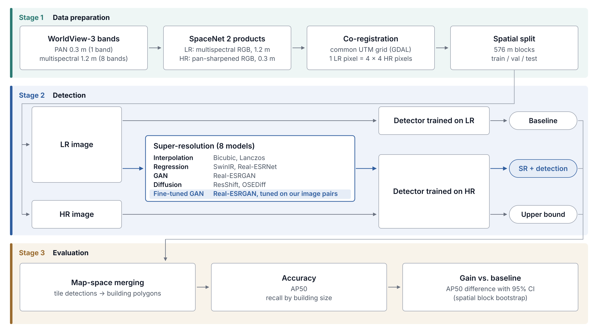
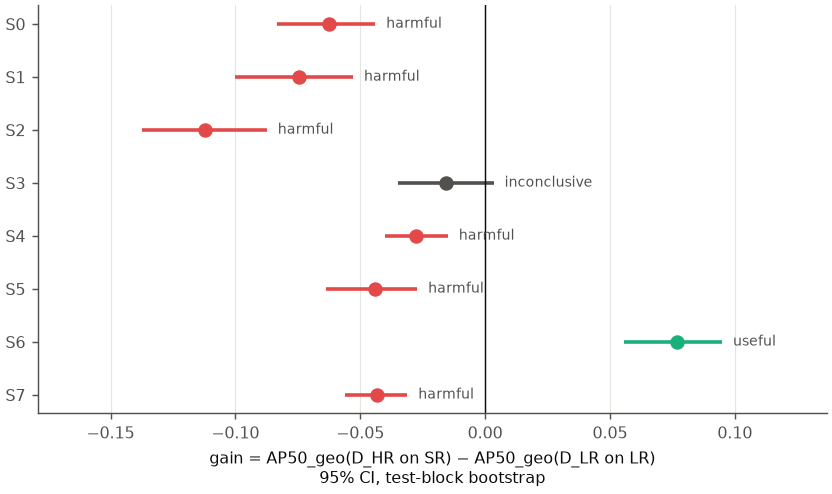
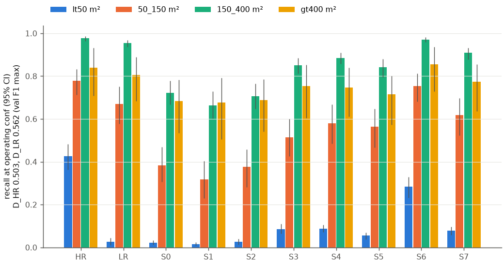
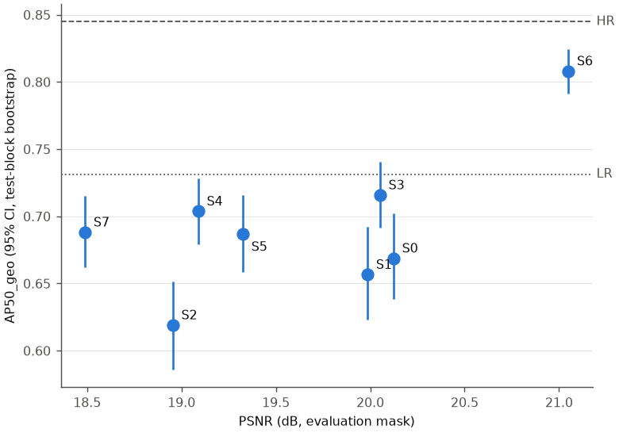
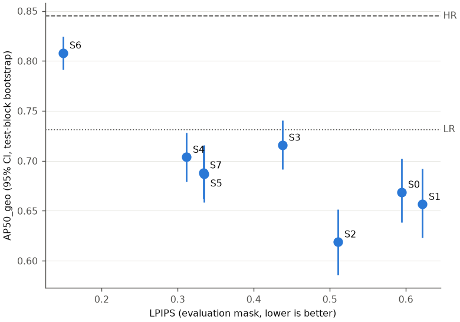
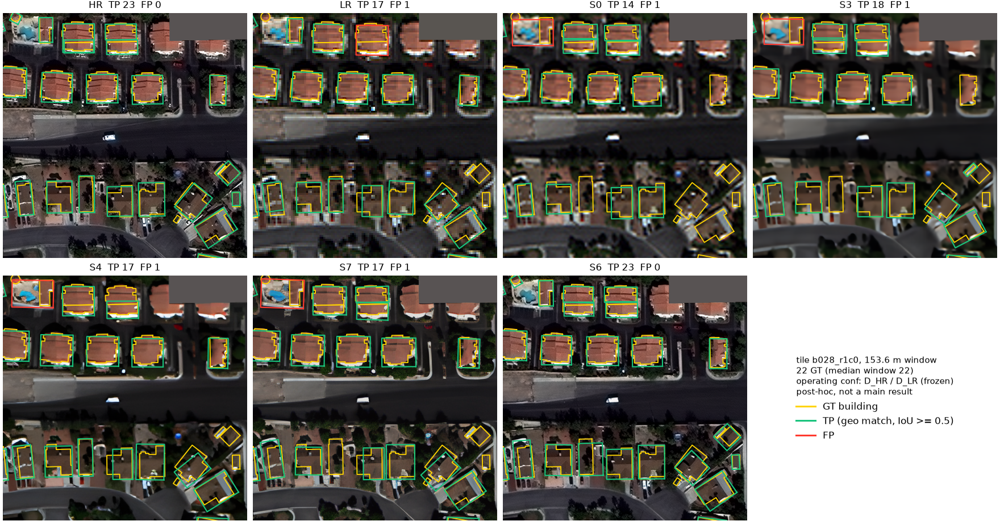
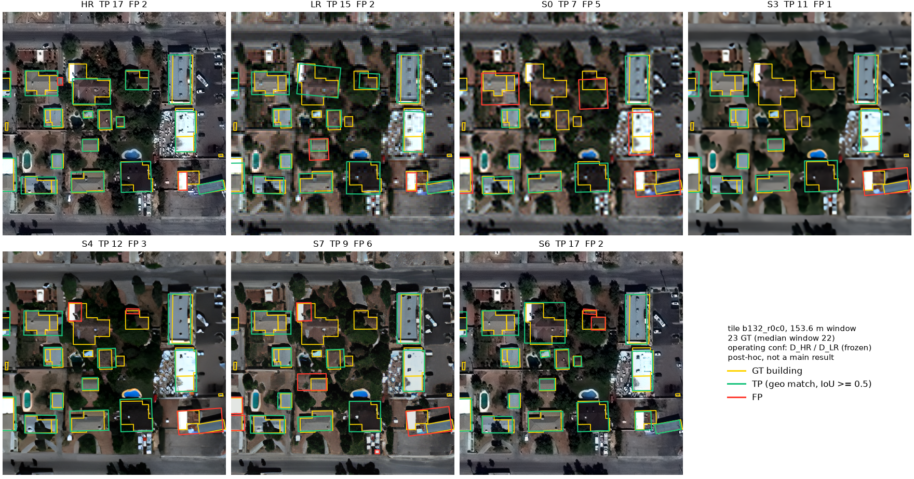
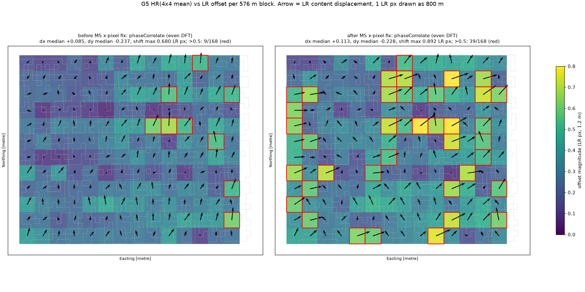

# rs-sr-detect: does ×4 super-resolution of real multispectral imagery help a fixed building detector?

Korean: [README.ko.md](README.ko.md)

**Short answer: only when the SR model is fine-tuned on real sensor pairs.** Eight super-resolution (SR) methods were applied to real 1.2 m WorldView-3 multispectral imagery and judged by building-detection accuracy, not by PSNR. With a detector trained on HR and kept fixed, Real-ESRGAN fine-tuned on SpaceNet MS–PS pairs was the only method that beat detecting on the low-resolution input directly. Every public SR model, including both diffusion models, was harmful or inconclusive.



*Figure 1. Pipeline. Stage 1: a WorldView-3 multispectral image (LR) and the pan-sharpened image of the same acquisition (HR) are co-registered on one UTM grid and split by spatial blocks. Stage 2: the same LR image goes straight to a detector trained on LR (baseline) or through one of 8 super-resolution models to a detector trained on HR, which also runs on the real HR image (upper bound). Stage 3: detections are merged into building polygons and each SR model is compared with the baseline by its AP50 gain and a block-bootstrap 95% CI.*

This repository is a proxy experiment for one situation: only 1.2 m-class imagery without a panchromatic band is available (another satellite, or a product delivered without PAN), and it has to be brought to 0.3 m. SpaceNet 2 (AOI_2_Vegas) provides both products from the same WorldView-3 acquisition. The real 1.2 m multispectral (MS) GeoTIFF is the low-resolution (LR) input, and the 0.3 m pan-sharpened RGB (PS-RGB) is the high-resolution (HR) reference. No synthetic degradation is used, and the scale factor is ×4 only.

## Results at a glance

| Input to the detector | AP50_geo [95% CI] | gain vs LR [95% CI] | Verdict |
| --- | --- | --- | --- |
| Real HR, 0.3 m (upper bound) | 0.845 [0.828, 0.861] | – | – |
| **SR fine-tuned on real MS–PS pairs (S6)** | **0.808 [0.791, 0.825]** | **+0.077 [+0.056, +0.095]** | **useful**, recovers 68% of the gap |
| LR directly, 1.2 m (path 1 baseline) | 0.731 [0.710, 0.754] | – | – |
| Best public SR: Real-ESRNet (S3) | 0.716 [0.692, 0.741] | -0.015 [-0.035, +0.003] | inconclusive |
| One-step diffusion: OSEDiff (S7) | 0.688 [0.662, 0.715] | -0.043 [-0.056, -0.031] | harmful |
| Bicubic interpolation (S0) | 0.669 [0.639, 0.702] | -0.063 [-0.083, -0.044] | harmful |

- **Small buildings are where SR matters.** For buildings under 50 m², recall rose from 0.027 (LR) to 0.283 (S6). The public SR models stayed at or below 0.088 and lost recall on the 50–400 m² houses that the LR detector already found.
- **PSNR did not predict usefulness.** The Spearman correlation between PSNR rank and detection rank was 0.381 (p 0.352, n=8), and 0.071 with S6 removed.
- **Generative SR adds buildings that are not there.** OSEDiff had the highest false-positive ratio, 0.204, against 0.139 on real HR.

All numbers come from [results/summary.csv](results/summary.csv) and [results/posthoc/](results/posthoc). They hold only for this dataset (one city, one acquisition) and for a detector trained on HR and kept fixed.

<details>
<summary><b>All 8 SR models, sorted by AP50_geo</b></summary>

| SR model | Family | AP50_geo [95% CI] | gain vs LR [95% CI] | Verdict |
| --- | --- | --- | --- | --- |
| Real-ESRGAN fine-tuned (S6) | Fine-tuned GAN | **0.808 [0.791, 0.825]** | **+0.077 [+0.056, +0.095]** | **useful** |
| Real-ESRNet (S3) | Regression | 0.716 [0.692, 0.741] | -0.015 [-0.035, +0.003] | inconclusive |
| Real-ESRGAN (S4) | GAN | 0.704 [0.679, 0.728] | -0.028 [-0.040, -0.015] | harmful |
| OSEDiff (S7) | Diffusion | 0.688 [0.662, 0.715] | -0.043 [-0.056, -0.031] | harmful |
| ResShift (S5) | Diffusion | 0.687 [0.658, 0.716] | -0.044 [-0.064, -0.027] | harmful |
| Bicubic (S0) | Interpolation | 0.669 [0.639, 0.702] | -0.063 [-0.083, -0.044] | harmful |
| Lanczos (S1) | Interpolation | 0.657 [0.623, 0.692] | -0.075 [-0.100, -0.053] | harmful |
| SwinIR (S2) | Regression | 0.619 [0.586, 0.651] | -0.112 [-0.137, -0.087] | harmful |

Full tables, recall by building size and image-quality metrics are in [Main results](#main-results).

</details>

## Benchmark dataset

**SpaceNet 2, AOI_2_Vegas** is a public building-footprint benchmark built on WorldView-3 imagery of Las Vegas. One WorldView-3 acquisition records a panchromatic (PAN) band and 8 multispectral (MS) bands at the same time. The MS pixels are 4× coarser than the PAN pixels; that is a property of the sensor, not a downsampling step. SpaceNet ships the raw bands and pan-sharpened products, which fuse PAN detail with MS colour.

| SpaceNet 2 folder | Content | Pixel | Used here |
| --- | --- | --- | --- |
| PAN | 1 panchromatic band | about 0.3 m | no |
| MS | 8 bands: Coastal, Blue, Green, Yellow, Red, Red Edge, NIR1, NIR2 | about 1.2 m (163 × 163 px per chip) | **LR input**, bands 5, 3, 2 (Red, Green, Blue) |
| PS-MS | 8 pan-sharpened bands | about 0.3 m | no |
| PS-RGB | pan-sharpened Red, Green, Blue | about 0.3 m (650 × 650 px per chip) | **HR reference** |
| geojson_buildings | building footprint polygons | – | labels |

- **Area.** Each chip covers about 157.8 m × 194.7 m. The 3,850 labelled train chips are scattered between unlabelled test chips, so the densest window of about 8.36 km × 6.81 km was chosen and only its 1,168 train chips were downloaded.
- **Values.** Both products are 11-bit; each is converted to 8-bit with its own percentile stretch.
- **Labels and split.** 35,265 buildings, assigned by 576 m spatial blocks to train / val / test: 118 / 26 / 24 blocks with 23,394 / 5,020 / 5,194 buildings.
- **What "HR" means here.** The HR reference is pan-sharpened, so it is derived from PAN and the same MS bands of the same acquisition. It is the best available 0.3 m colour image, not an independent measurement.

<details>
<summary><b>Co-registration: what "a common UTM grid" means</b></summary>

- SpaceNet chips use geographic coordinates (EPSG:4326, degrees). At the latitude of Las Vegas a pixel that is square in degrees is not square on the ground: PS-RGB pixels are 0.2427 m × 0.2995 m and MS pixels 0.9677 m × 1.1944 m (east-west × north-south).
- UTM (Universal Transverse Mercator) is a map projection whose coordinates are in metres. Las Vegas lies in zone 11N (EPSG:32611).
- Both products were warped with GDAL to UTM 11N on aligned grids: HR at 0.3 m and LR at 1.2 m from the same origin, so one LR pixel covers exactly 4 × 4 HR pixels (checked by assertion). HR, LR, every SR output and the labels then share pixel positions and map coordinates.
- Before warping, the MS chip metadata was corrected for the 650 / 4 = 162.5 px chip phase, and alignment was checked per block with ECC ([Engineering findings](#engineering-findings)).

</details>

## What was done

- **A real sensor pair, not synthetic downsampling.** The LR input is the 1.2 m multispectral product and the reference is the 0.3 m pan-sharpened product of the same WorldView-3 acquisition (SpaceNet 2, Las Vegas, 1,168 chips).
- **A georeferenced GDAL and OpenCV pipeline.** Both products are warped to one UTM grid on which 1 LR pixel covers exactly 4×4 HR pixels. Tile predictions are merged in map coordinates and matched to building footprints there.
- **Two detectors trained here.** Both use the same architecture and start from the official DOTA-pretrained YOLO26s-OBB weights, with the same seed and epoch budget: one is trained on LR tiles (the baseline), the other on HR tiles. The HR detector is then frozen and applied to the output of each of **8 SR methods from 5 families** (interpolation, regression, GAN, diffusion, domain fine-tuning).
- **A verdict rule fixed in advance.** A spatial-block bootstrap CI on the AP50 gain decides useful, harmful or inconclusive. All thresholds were set on val before a single test run ([docs/frozen_eval.md](docs/frozen_eval.md)).

<details>
<summary><b>How the fine-tuned SR model (S6) was trained, and how it compares with the same model before fine-tuning</b></summary>

S6 is Real-ESRGAN fine-tuned in this project on real image pairs. It starts from the same public weights as S4, so S6 − S4 isolates the effect of fine-tuning. Source: [results/s6_finetune.json](results/s6_finetune.json), [results/S6_realesrgan_ft_spacenet.yml](results/S6_realesrgan_ft_spacenet.yml), [docs/decisions.md](docs/decisions.md).

| Item | Setting |
| --- | --- |
| Starting weights | official RealESRGAN_x4plus (generator) and RealESRGAN_x4plus_netD (U-Net discriminator) |
| Recipe | official Real-ESRGAN paired-data fine-tuning config, with weight paths, data paths, iterations and milestones set for this run |
| Training data | 433 train-block tile pairs: real multispectral 1.2 m (LR) with pan-sharpened 0.3 m (HR) of the same place |
| Losses | L1 pixel loss, perceptual loss, GAN loss |
| Optimiser | Adam, learning rate 1e-4, batch 12, random 256 px HR crops |
| Iterations | 23,600 of the official 400,000 (5.9%), from a measured 0.4117 s per iteration within 3 h × 0.9 |
| Time | 9,481 s on one RTX 4090 |
| Checkpoint | the last one; the largest weight change from the start was 0.237, so training did change the model |
| Leakage control | trained on train blocks only and evaluated on separate test blocks |

| Metric (test blocks) | S4, public weights | S6, fine-tuned |
| --- | --- | --- |
| PSNR | 19.09 | 21.05 |
| SSIM | 0.549 | 0.637 |
| LPIPS (lower is better) | 0.312 | 0.149 |
| AP50_geo [95% CI] | 0.704 [0.679, 0.728] | 0.808 [0.791, 0.825] |
| Recall, buildings under 50 m² | 0.088 | 0.283 |
| False-positive ratio | 0.172 | 0.147 |

The two AP50_geo intervals do not overlap. The comparison holds for a detector trained on HR and kept fixed.

</details>

## Problems solved along the way

- **The data had holes.** SpaceNet interleaves train and test chips, so no contiguous labelled area exists. Chip footprints became the valid mask, holes were filled with a neutral colour, and a 9.6 m border was excluded from evaluation. The method ranking was the same at 0, 8 and 16 LR px insets.
- **The registration check was wrong before the data was.** 110 of 168 blocks first failed alignment. A synthetic-shift test showed that OpenCV `phaseCorrelate` returns exactly +0.5 px on odd padded sizes. After the measurement was fixed, the remaining offset was traced to a 650 / 4 = 162.5 px chip phase and corrected by a geometric rule, not by per-chip fitting.
- **A weak baseline would inflate every gain.** Whether the LR detector was under-trained was tested against a threshold written down in advance. It was met, so both detectors were retrained at 200 epochs.

Details: [Method](#method) · [Main results](#main-results) · [Post-hoc analysis](#post-hoc-analysis-post-hoc-not-a-primary-result) · [Engineering findings](#engineering-findings) · [Limitations](#limitations) · [Reproduce](#reproduce)

## Question and motivation

SR papers usually rank models by PSNR, SSIM or LPIPS. A downstream user asks a different question: does running SR before an existing analysis model give better maps than running the analysis on the original data? This experiment answers it for one task, rotated building detection. The primary metric is geographic AP50 after merging tiles (AP50_geo). Image-quality metrics are used only to explain the detection results.

- **Shermeyer & Van Etten 2019** ([arXiv:1812.04098](https://arxiv.org/abs/1812.04098), EarthVision) super-resolved satellite imagery with VDSR and a random-forest method at ×2, ×4 and ×8 and measured object detection. They found the largest benefit when going from 30 cm to 15 cm and smaller benefits at coarser resolutions. Their detectors were trained on each resolution and on SR output. This experiment differs in three ways: the LR input is a real sensor product rather than a resampled image, the detector is trained once on HR and kept fixed, and the objects are buildings.
- **GeoSR-Bench** ([arXiv:2605.00310](https://arxiv.org/abs/2605.00310)) benchmarks 9 SR models on co-located multi-platform image pairs, evaluating downstream tasks (land-cover segmentation, infrastructure mapping, biophysical variable estimation) alongside perceptual quality. It reports that gains on fidelity metrics often do not carry over to downstream tasks. This repository is a smaller, single-scene case study with the same motivation: one city, one sensor pair, one task, with block-level bootstrap confidence intervals and settings frozen before the test evaluation.

## Data and setup

- **Source:** SpaceNet 2, AOI_2_Vegas, train split (`s3://spacenet-dataset/spacenet/SN2_buildings/train/AOI_2_Vegas/`). Only the PS-RGB, MS and building GeoJSON of 1,168 chips were downloaded. Details are in [docs/data_report.md](docs/data_report.md).
- **LR input:** MS bands 5, 3, 2 (Red, Green, Blue of the WorldView-3 8-band order). The band choice was checked by correlating each MS band with PS-RGB averaged to the MS grid. The bands are warped to a 1.2 m UTM grid (EPSG:32611).
- **HR reference:** PS-RGB warped to a 0.3 m grid aligned so that 1 LR pixel covers exactly 4×4 HR pixels (asserted). **PS-RGB is a pan-sharpened product** made from the PAN and MS bands of the same acquisition, not an independent 0.3 m measurement.
- **8-bit conversion:** each product gets its own 2–98 percentile stretch per band, computed on train blocks only.
- **Spatial split:** 576 m blocks (LR 480 px) assigned to train / val / test by building count. The result was 118 / 26 / 24 blocks with 23,394 / 5,020 / 5,194 buildings. Tiles are 307.2 m (HR 1024 px, LR 256 px), 2×2 per block, and never cross a block boundary.
- **NoData and evaluation zone:** SpaceNet train and test chips are spatially interleaved, so the downloaded window has holes. The valid mask is the union of chip footprints, not pixel values. Invalid pixels are filled with the train-block mean colour, and every SR output is overwritten with the same fill. The evaluation zone is the footprint shrunk inward by 9.6 m (8 LR px). Ground truth and predictions with at least 50% of their area outside this zone are dropped from TP, FP and FN. The 0 / 8 / 16 LR px sensitivity is reported below.

## Method

- **Path 1 (lower bound):** D_LR, a YOLO26s-OBB trained on LR tiles (imgsz 256), detects on LR.
- **Path 2:** D_HR, the same architecture trained on HR tiles (imgsz 1024), detects on each SR output. D_HR is never retrained for an SR method. Every conclusion therefore carries the condition "with a detector trained on HR and kept fixed".
- **Upper bound:** D_HR on HR.
- **SR methods (×4, same 8-bit LR tiles as input):**

  | ID | Category | Method |
  |---|---|---|
  | S0 / S1 | Interpolation | GDAL cubic / lanczos |
  | S2 | Regression | SwinIR classical ×4 (DF2K) |
  | S3 | Regression | Real-ESRNet x4plus |
  | S4 | GAN | Real-ESRGAN x4plus |
  | S5 | Diffusion (efficient) | ResShift v3 |
  | S6 | Domain fine-tuning | Real-ESRGAN fine-tuned on train-block MS–PS pairs |
  | S7 | One-step diffusion | OSEDiff |

  S6 used the official paired-data fine-tuning config, starting from RealESRGAN_x4plus. It ran 23,600 iterations, limited by a measured 0.4117 s/iter and a 3 h budget. S6 − S4 is therefore the effect of fine-tuning.
- **Merging and matching:** tile predictions are merged with `cv2.dnn.NMSBoxesRotated` per block, at IoU 0.5. Predictions are then matched to GT (minimum rotated rectangle of each footprint) in UTM at rotated IoU ≥ 0.5.
- **Metrics:** AP50_geo uses predictions with conf ≥ 0.001 and max_det 3000. Recall by area and false positives use an operating confidence chosen on val by maximum F1: 0.503 for D_HR (also applied to every SR row) and 0.562 for D_LR.
- **Verdict:** 95% CIs come from a test-block bootstrap (1,000 resamples, seed 0). gain = AP50_geo(path 2) − AP50_geo(path 1), computed on the same resample. A method is **useful** if the gain CI lower bound is above 0, **harmful** if the upper bound is below 0, and **inconclusive** otherwise. recovery = gain / (AP50_geo(HR) − AP50_geo(LR)).
- **Settings frozen before test:** detector weights (SHA256), max_det, merge IoU, operating confidences, buffer, Canny thresholds and the code commit were recorded in [docs/frozen_eval.md](docs/frozen_eval.md) before the test blocks were evaluated. Everything was chosen on train or val blocks. The later post-hoc rerun is logged in the same file.
- **200-epoch decision (rule fixed in advance):** the first D_LR ran to the 100-epoch default without early stopping. A separate 200-epoch D_LR was trained under a rule written down before seeing its result: retrain both detectors at 200 epochs if LR val AP50_geo rises by ≥ 0.01. It rose from 0.6619 to 0.6743 (+0.0124), so both detectors were retrained with epochs 200 and patience 20. D_HR early-stopped at 86 epochs; D_LR ran all 200. Best weights were chosen on val by the Ultralytics default fitness, mAP50-95 ([docs/decisions.md](docs/decisions.md)).

## Main results

Test blocks, 4,426 GT buildings in the evaluation zone, buffer 8 LR px. Source: [results/summary.csv](results/summary.csv).

<!-- BEGIN:main -->
| method | path | AP50_geo [95% CI] | gain vs LR [95% CI] | recovery | verdict | FP |
|---|---|---|---|---|---|---|
| HR | HR (D_HR on HR) | 0.845 [0.828, 0.861] | – | – | – | 584 |
| LR | path1 (D_LR on LR) | 0.731 [0.710, 0.754] | – | – | – | 415 |
| S0_gdal_cubic | path2 (D_HR on SR) | 0.669 [0.639, 0.702] | -0.063 [-0.083, -0.044] | -0.55 | **harmful** | 290 |
| S1_gdal_lanczos | path2 (D_HR on SR) | 0.657 [0.623, 0.692] | -0.075 [-0.100, -0.053] | -0.66 | **harmful** | 268 |
| S2_swinir_classical_x4 | path2 (D_HR on SR) | 0.619 [0.586, 0.651] | -0.112 [-0.137, -0.087] | -0.99 | **harmful** | 398 |
| S3_realesrnet_x4plus | path2 (D_HR on SR) | 0.716 [0.692, 0.741] | -0.015 [-0.035, +0.003] | -0.14 | **inconclusive** | 433 |
| S4_realesrgan_x4plus | path2 (D_HR on SR) | 0.704 [0.679, 0.728] | -0.028 [-0.040, -0.015] | -0.24 | **harmful** | 599 |
| S5_resshift_v3_x4 | path2 (D_HR on SR) | 0.687 [0.658, 0.716] | -0.044 [-0.064, -0.027] | -0.39 | **harmful** | 452 |
| S6_realesrgan_ft_spacenet | path2 (D_HR on SR) | 0.808 [0.791, 0.825] | +0.077 [+0.056, +0.095] | 0.68 | **useful** | 595 |
| S7_osediff_x4 | path2 (D_HR on SR) | 0.688 [0.662, 0.715] | -0.043 [-0.056, -0.031] | -0.38 | **harmful** | 763 |
<!-- END:main -->



Recall by building area (operating confidence) and its gain verdict against path 1:

<!-- BEGIN:recall -->
| method | <50 m² | 50–150 m² | 150–400 m² | >400 m² | verdict vs LR (<50 / 50–150 / 150–400 / >400) |
|---|---|---|---|---|---|
| HR | 0.427 [0.364, 0.482] | 0.779 [0.714, 0.833] | 0.977 [0.964, 0.987] | 0.839 [0.708, 0.932] | – |
| LR | 0.027 [0.012, 0.045] | 0.670 [0.576, 0.752] | 0.955 [0.937, 0.969] | 0.806 [0.684, 0.889] | – |
| S0_gdal_cubic | 0.023 [0.012, 0.034] | 0.383 [0.306, 0.468] | 0.721 [0.667, 0.779] | 0.683 [0.535, 0.782] | inconclusive / harmful / harmful / harmful |
| S1_gdal_lanczos | 0.015 [0.007, 0.023] | 0.317 [0.230, 0.403] | 0.662 [0.601, 0.728] | 0.677 [0.504, 0.792] | inconclusive / harmful / harmful / harmful |
| S2_swinir_classical_x4 | 0.026 [0.013, 0.040] | 0.377 [0.281, 0.457] | 0.707 [0.647, 0.764] | 0.688 [0.542, 0.786] | inconclusive / harmful / harmful / harmful |
| S3_realesrnet_x4plus | 0.085 [0.065, 0.109] | 0.514 [0.426, 0.600] | 0.850 [0.813, 0.885] | 0.753 [0.604, 0.852] | useful / harmful / harmful / harmful |
| S4_realesrgan_x4plus | 0.088 [0.071, 0.105] | 0.580 [0.485, 0.667] | 0.884 [0.857, 0.909] | 0.747 [0.612, 0.840] | useful / harmful / harmful / harmful |
| S5_resshift_v3_x4 | 0.055 [0.038, 0.070] | 0.564 [0.466, 0.647] | 0.841 [0.795, 0.880] | 0.715 [0.574, 0.802] | useful / harmful / harmful / harmful |
| S6_realesrgan_ft_spacenet | 0.283 [0.232, 0.330] | 0.753 [0.682, 0.812] | 0.971 [0.958, 0.982] | 0.855 [0.729, 0.938] | useful / useful / useful / useful |
| S7_osediff_x4 | 0.078 [0.059, 0.096] | 0.618 [0.523, 0.698] | 0.908 [0.878, 0.932] | 0.774 [0.636, 0.856] | useful / harmful / harmful / inconclusive |
<!-- END:recall -->



Image-quality metrics (evaluation mask) and processing time (model loading excluded; loading time listed separately):

<!-- BEGIN:quality -->
| method | PSNR | SSIM | LPIPS | edge_precision | edge_recall | sharpness_ratio | SR s/km² | SR load s | det s/km² |
|---|---|---|---|---|---|---|---|---|---|
| S0_gdal_cubic | 20.12 | 0.573 | 0.595 | 0.821 | 0.464 | 0.027 | 6.8 | – | 0.4 |
| S1_gdal_lanczos | 19.99 | 0.570 | 0.622 | 0.820 | 0.480 | 0.028 | 7.1 | – | 0.4 |
| S2_swinir_classical_x4 | 18.95 | 0.561 | 0.511 | 0.812 | 0.580 | 0.203 | 14.4 | 27.0 | 0.4 |
| S3_realesrnet_x4plus | 20.05 | 0.594 | 0.438 | 0.871 | 0.414 | 0.081 | 1.1 | 26.6 | 0.4 |
| S4_realesrgan_x4plus | 19.09 | 0.549 | 0.312 | 0.836 | 0.579 | 0.512 | 1.2 | 25.8 | 0.5 |
| S5_resshift_v3_x4 | 19.32 | 0.522 | 0.335 | 0.786 | 0.664 | 0.691 | 14.9 | 38.0 | 0.5 |
| S6_realesrgan_ft_spacenet | 21.05 | 0.637 | 0.149 | 0.890 | 0.805 | 0.847 | 1.2 | 29.1 | 0.5 |
| S7_osediff_x4 | 18.49 | 0.495 | 0.334 | 0.795 | 0.693 | 1.216 | 16.1 | 96.6 | 0.4 |
<!-- END:quality -->

Spearman correlation between the rank of each quality metric and the AP50_geo rank (the 8 SR methods):

<!-- BEGIN:spearman -->
| metric | Spearman ρ vs AP50_geo | p | n |
|---|---|---|---|
| PSNR | 0.381 | 0.352 | 8 |
| SSIM | 0.333 | 0.420 | 8 |
| LPIPS | 0.786 | 0.021 | 8 |
| edge_precision | 0.643 | 0.086 | 8 |
| edge_recall | 0.214 | 0.610 | 8 |
<!-- END:spearman -->

| PSNR vs AP50_geo | LPIPS vs AP50_geo |
|---|---|
|  |  |

Buffer sensitivity (evaluation-zone inset 0 / 8 / 16 LR px):

<!-- BEGIN:buffer -->
| method | 0 LR px: AP50 / gain / verdict | 8 LR px: AP50 / gain / verdict | 16 LR px: AP50 / gain / verdict |
|---|---|---|---|
| HR | 0.835 | 0.845 | 0.841 |
| LR | 0.717 | 0.731 | 0.733 |
| S0_gdal_cubic | 0.648 / -0.068 / harmful | 0.669 / -0.063 / harmful | 0.668 / -0.065 / harmful |
| S1_gdal_lanczos | 0.636 / -0.081 / harmful | 0.657 / -0.075 / harmful | 0.656 / -0.076 / harmful |
| S2_swinir_classical_x4 | 0.596 / -0.121 / harmful | 0.619 / -0.112 / harmful | 0.618 / -0.115 / harmful |
| S3_realesrnet_x4plus | 0.690 / -0.026 / harmful | 0.716 / -0.015 / inconclusive | 0.714 / -0.019 / harmful |
| S4_realesrgan_x4plus | 0.681 / -0.035 / harmful | 0.704 / -0.028 / harmful | 0.701 / -0.032 / harmful |
| S5_resshift_v3_x4 | 0.669 / -0.048 / harmful | 0.687 / -0.044 / harmful | 0.684 / -0.049 / harmful |
| S6_realesrgan_ft_spacenet | 0.796 / +0.079 / useful | 0.808 / +0.077 / useful | 0.807 / +0.074 / useful |
| S7_osediff_x4 | 0.669 / -0.048 / harmful | 0.688 / -0.043 / harmful | 0.689 / -0.044 / harmful |
<!-- END:buffer -->

Reading of the main results, with a detector trained on HR and kept fixed, on this dataset:

- S6 is the only useful method, both for AP50_geo and in every area bin. Its gain in buildings under 50 m² is +0.256 [+0.213, +0.298].
- S3, S4, S5 and S7 are useful only for buildings under 50 m² and harmful in the 50–150 and 150–400 m² bins. Their overall AP50_geo gain is negative or inconclusive.
- The ranking of methods is the same at all 3 buffer widths. S3 is harmful at 0 and 16 LR px and inconclusive at 8 LR px, so its verdict depends on the buffer.
- Time: S6 costs 1.164 s/km² of SR plus 29.07 s of model loading. This is on the same scale as D_HR detection (0.459 s/km² on S6 output). The diffusion models S5 and S7 take 14.901 and 16.150 s/km² and are harmful. See also [results/figures/report_e_time_vs_ap50.png](results/figures/report_e_time_vs_ap50.png).

## Post-hoc analysis (post-hoc, not a primary result)

These analyses were requested after the test results had been seen. They reuse the frozen detectors and evaluation settings and are stored separately in [results/posthoc/](results/posthoc/). [results/summary.csv](results/summary.csv) and the verdicts above are unchanged. CIs use the same block-bootstrap resamples (verified to reproduce the main AP50 and CI).

**Gain over bicubic interpolation (S0).** Against S0 rather than path 1, S3, S4, S6 and S7 are better and S1 and S2 are worse. This does not change the main verdicts, because S0 itself is harmful against path 1.

<!-- BEGIN:ph_s0 -->
| method | AP50_geo [95% CI] | AP50 − S0 [95% CI] | verdict |
|---|---|---|---|
| S1_gdal_lanczos | 0.657 [0.623, 0.692] | -0.012 [-0.017, -0.007] | worse |
| S2_swinir_classical_x4 | 0.619 [0.586, 0.651] | -0.050 [-0.080, -0.022] | worse |
| S3_realesrnet_x4plus | 0.716 [0.692, 0.741] | +0.047 [+0.031, +0.064] | better |
| S4_realesrgan_x4plus | 0.704 [0.679, 0.728] | +0.035 [+0.020, +0.052] | better |
| S5_resshift_v3_x4 | 0.687 [0.658, 0.716] | +0.018 [-0.004, +0.042] | inconclusive |
| S6_realesrgan_ft_spacenet | 0.808 [0.791, 0.825] | +0.139 [+0.113, +0.164] | better |
| S7_osediff_x4 | 0.688 [0.662, 0.715] | +0.019 [+0.002, +0.038] | better |
| S0_color | 0.657 [0.624, 0.692] | -0.012 [-0.019, -0.005] | worse |
| S3_color | 0.713 [0.690, 0.738] | +0.044 [+0.029, +0.061] | better |
<!-- END:ph_s0 -->

**Colour-correction control.** A per-band linear map (gain, offset) from LR 8-bit values to HR 8-bit values (4×4 mean) was fitted by least squares on train-block pixels inside the evaluation mask. It was applied to S0 and S3 to create S0_color and S3_color.

<!-- BEGIN:ph_colorfit -->
| band | gain | offset | R² |
|---|---|---|---|
| R | 0.888 | 8.53 | 0.917 |
| G | 0.882 | 7.87 | 0.907 |
| B | 0.855 | 13.43 | 0.892 |
<!-- END:ph_colorfit -->

<!-- BEGIN:ph_color -->
| method | AP50_geo [95% CI] | reference | reference AP50 | difference [95% CI] | verdict |
|---|---|---|---|---|---|
| S0_color | 0.657 [0.624, 0.692] | S6_realesrgan_ft_spacenet | 0.808 | -0.151 [-0.178, -0.122] | worse |
| S0_color | 0.657 [0.624, 0.692] | LR | 0.731 | -0.075 [-0.096, -0.055] | worse |
| S0_color | 0.657 [0.624, 0.692] | S0_gdal_cubic | 0.669 | -0.012 [-0.019, -0.005] | worse |
| S3_color | 0.713 [0.690, 0.738] | S6_realesrgan_ft_spacenet | 0.808 | -0.095 [-0.114, -0.074] | worse |
| S3_color | 0.713 [0.690, 0.738] | LR | 0.731 | -0.018 [-0.037, +0.001] | inconclusive |
| S3_color | 0.713 [0.690, 0.738] | S3_realesrnet_x4plus | 0.716 | -0.003 [-0.009, +0.004] | inconclusive |
<!-- END:ph_color -->

The global linear colour shift did not help: S0_color is worse than S0, and S3_color is inconclusive against S3. Both stay well below S6, by -0.151 and -0.095 with CIs that exclude 0. The S6 gain is therefore not explained by a global linear color shift. This control does not show what the S6 gain does come from, and non-linear or local colour differences were not tested.

**Recall by area, false positives and prediction counts at the operating confidence.**

<!-- BEGIN:ph_area -->
| method | conf | <50 m² | 50–150 m² | 150–400 m² | >400 m² | FP | predictions | FP ratio |
|---|---|---|---|---|---|---|---|---|
| HR | 0.503 | 0.427 [0.364, 0.482] | 0.779 [0.714, 0.833] | 0.977 [0.964, 0.987] | 0.839 [0.708, 0.932] | 584 | 4202 | 0.139 |
| LR | 0.562 | 0.027 [0.012, 0.045] | 0.670 [0.576, 0.752] | 0.955 [0.937, 0.969] | 0.806 [0.684, 0.889] | 415 | 3509 | 0.118 |
| S0_gdal_cubic | 0.503 | 0.023 [0.012, 0.034] | 0.383 [0.306, 0.468] | 0.721 [0.667, 0.779] | 0.683 [0.535, 0.782] | 290 | 2535 | 0.114 |
| S1_gdal_lanczos | 0.503 | 0.015 [0.007, 0.023] | 0.317 [0.230, 0.403] | 0.662 [0.601, 0.728] | 0.677 [0.504, 0.792] | 268 | 2303 | 0.116 |
| S2_swinir_classical_x4 | 0.503 | 0.026 [0.013, 0.040] | 0.377 [0.281, 0.457] | 0.707 [0.647, 0.764] | 0.688 [0.542, 0.786] | 398 | 2606 | 0.153 |
| S3_realesrnet_x4plus | 0.503 | 0.085 [0.065, 0.109] | 0.514 [0.426, 0.600] | 0.850 [0.813, 0.885] | 0.753 [0.604, 0.852] | 433 | 3178 | 0.136 |
| S4_realesrgan_x4plus | 0.503 | 0.088 [0.071, 0.105] | 0.580 [0.485, 0.667] | 0.884 [0.857, 0.909] | 0.747 [0.612, 0.840] | 599 | 3485 | 0.172 |
| S5_resshift_v3_x4 | 0.503 | 0.055 [0.038, 0.070] | 0.564 [0.466, 0.647] | 0.841 [0.795, 0.880] | 0.715 [0.574, 0.802] | 452 | 3183 | 0.142 |
| S6_realesrgan_ft_spacenet | 0.503 | 0.283 [0.232, 0.330] | 0.753 [0.682, 0.812] | 0.971 [0.958, 0.982] | 0.855 [0.729, 0.938] | 595 | 4046 | 0.147 |
| S7_osediff_x4 | 0.503 | 0.078 [0.059, 0.096] | 0.618 [0.523, 0.698] | 0.908 [0.878, 0.932] | 0.774 [0.636, 0.856] | 763 | 3738 | 0.204 |
| S0_color | 0.503 | 0.017 [0.008, 0.027] | 0.366 [0.292, 0.444] | 0.675 [0.618, 0.734] | 0.640 [0.514, 0.735] | 262 | 2365 | 0.111 |
| S3_color | 0.503 | 0.077 [0.055, 0.100] | 0.516 [0.435, 0.594] | 0.836 [0.801, 0.871] | 0.758 [0.610, 0.852] | 407 | 3113 | 0.131 |
<!-- END:ph_area -->

- S6 recall for buildings under 50 m² is 0.283. Every other SR method is at or below 0.088, and HR is at 0.427.
- S7 (OSEDiff) has the most false positives (763) and the highest FP ratio (0.204). S4 follows with an FP ratio of 0.172. HR has 0.139.
- **Fewer predictions from public SR at a fixed confidence.** At the D_HR operating confidence (0.503), D_HR gives 4,202 predictions on HR and 4,046 on S6. On S0, S1 and S2 it gives only 2,535, 2,303 and 2,606. The low FP counts of the interpolators (290, 268) come with this drop in prediction count, not with a cleaner output: their FP ratios (0.114, 0.116) are close to HR, while their recall drops in every bin above 50 m². The detector's confidence shifts on these inputs, so a confidence threshold calibrated on HR passes fewer boxes. Re-calibrating the confidence per SR method was not done, because it would require val SR outputs and would change the frozen settings.

**Spearman without S6.** S6 is best on both PSNR and AP50_geo, so it alone can drive the correlation.

<!-- BEGIN:ph_spearman -->
| metric | set | ρ | p |
|---|---|---|---|
| PSNR | all SR (n=8) | 0.381 | 0.352 |
| PSNR | excl. S6 (n=7) | 0.071 | 0.879 |
| SSIM | all SR (n=8) | 0.333 | 0.420 |
| SSIM | excl. S6 (n=7) | 0.000 | 1.000 |
| LPIPS | all SR (n=8) | 0.786 | 0.021 |
| LPIPS | excl. S6 (n=7) | 0.679 | 0.094 |
| edge_precision | all SR (n=8) | 0.643 | 0.086 |
| edge_precision | excl. S6 (n=7) | 0.464 | 0.294 |
<!-- END:ph_spearman -->

Without S6, PSNR and SSIM have almost no rank correlation with AP50_geo (ρ 0.071 and 0.000). LPIPS keeps a weak trend (n=7, p=0.094). With 7 or 8 methods these correlations are imprecise.

**Qualitative examples.** Two test windows of 153.6 m with a median building count. GT is yellow, TP green, FP red; matching is the geographic matching at the operating confidence.





An offline viewer of all 96 test tiles (per-tile detections, |SR−HR|, Canny edges, before/after slider) is generated by `run.py report_viewer` into `results/report/` (not committed because of its size). The tile-level F1 values in the viewer are for reference only; the official metrics are those in [results/summary.csv](results/summary.csv).

## Engineering findings

- **SpaceNet train and test chips are spatially interleaved.** In AOI_2_Vegas the train chips occupy 54% of the chip grid (3,850 of 7,120 cells), scattered between test chips that have no public labels. The largest hole-free square is 4×4 chips, so a contiguous 1,200-chip area does not exist. The densest rectangle (35 × 53 chips, 1,168 train chips, density 0.63) was used, with the holes handled by the footprint mask. Evidence: [docs/data_report.md](docs/data_report.md), [docs/decisions.md](docs/decisions.md).
- **OpenCV `phaseCorrelate` has an exact +0.5 px bias on odd padded sizes.** `phaseCorrelate` pads its input to `getOptimalDFTSize`. On any axis where that size is odd, the estimate is biased by exactly +0.5 px. With identical images, widths 128, 144, 150 and 160 gave 0.000 and widths 129, 130 and 135 gave 0.500. In a synthetic test on 41 chips (HR averaged to 1.2 m, shifted by 0, 0.25 and 0.5 px), phaseCorrelate returned +0.500 at zero shift on the east–west axis, while ECC had a maximum error of 0.017 px. The first registration check failure (110/168 blocks over 0.5 LR px) was this bias. The fix crops each window to an even optimal DFT size and records ECC as a cross-check. Evidence: [docs/data_report.md](docs/data_report.md), [scripts/diag/g5_investigate.py](scripts/diag/g5_investigate.py).
- **MS chip origin phase from 162.5.** Each 650 px PS-RGB chip has a 163 px MS chip with the same corner coordinates, but 650 / 4 = 162.5. The metadata stretches the MS pixel to fit the chip. Chip-centre east–west offsets split by global chip column parity: even columns -0.125 and odd columns +0.390 MS px, a difference of 0.515 MS px. The correction is geometric and uses no per-chip measurement: the east–west pixel is set to 4× PS, and the origin of odd-column chips is moved by −2 PS px. After it the residual IQR width was 0.106 MS px, and the number of blocks over 0.5 LR px fell from 9 to 6 of 168 (all train, all caused by the north–south offset). Evidence: [docs/decisions.md](docs/decisions.md), [scripts/diag/g5_phase.py](scripts/diag/g5_phase.py), [scripts/diag/g5_rule_sim.py](scripts/diag/g5_rule_sim.py), [results/figures/g5_before_after/](results/figures/g5_before_after/).
- **North–south residual left uncorrected.** LR content sits north of HR by a block ECC median of -0.265 LR px (IQR -0.345 to -0.199), about 0.3 m, with the same sign across the area. A north–south pixel-size hypothesis made it worse, raising the blocks over 0.5 LR px from 6 to 69 of 168, so it was not applied. The cause is unknown. The largest test-block offset is 0.496 LR px, just under the 0.5 threshold. Evidence: [docs/data_report.md](docs/data_report.md), [results/figures/g5_offset_map.png](results/figures/g5_offset_map.png).



## Limitations

- **Single city and single acquisition.** One city (Las Vegas), one WorldView-3 acquisition, only part of the AOI (1,168 chips), one class (building), one scale (×4).
- **HR is a pan-sharpened product.** The reference is derived from the same acquisition's PAN and MS bands, so it is not an independent 0.3 m measurement. HR and LR also differ in colour as products; each has its own percentile stretch.
- **Fixed detector.** Every result of path 2 holds only for a detector trained on HR and kept fixed. With one detector (YOLO26s-OBB) trained on pan-sharpened texture, the experiment cannot separate "SR restores information" from "SR output resembles the pan-sharpened texture the detector was trained on". Training a detector on each SR output was not done.
- **Colour control.** Only a global per-band linear colour correction was tested (post-hoc).
- **Few methods.** With 8 SR methods (7 without S6), the Spearman correlations have low reliability.
- **S6 generalisation.** S6 was fine-tuned on MS–PS pairs from train blocks of the same city and acquisition. Generalisation to other areas or sensors was not tested.
- **SD2.1-base mirror.** S7 depends on SD2.1-base, which was downloaded from the personal mirror linked in the OSEDiff README (Manojb/stable-diffusion-2-1-base, commit in [third_party/VERSIONS.md](third_party/VERSIONS.md)). It was not verified to be identical to the stabilityai original, which was not accessible.
- **Training degradation mismatch.** The public SR models were trained on synthetic or other-domain degradations, not on real MS characteristics. For example, the MS bands contain values at the 11-bit ceiling.
- **Registration.** The uncorrected north–south offset of about 0.3 m remains in the comparison between path 1 and path 2 (see Engineering findings).
- **Box shape.** GT and predictions are compared as rotated rectangles. For L- or U-shaped buildings the rectangle is larger than the roof, so IoU matching can differ from the true outline. Area bins use the polygon area.
- **Calibration.** The operating confidence is calibrated on HR val and applied unchanged to SR outputs (see the prediction-count finding above).
- **Excluded methods.** AdcSR (S8) was disabled in the config (`enable_adcsr: false`). Anime-domain models such as RealESRGAN_x4plus_anime_6B were excluded because their training domain differs.

## Reproduce

- **Hardware used:** 1× RTX 4090 (24,564 MiB), a cgroup limit of 13.6 CPU cores and 62 GB RAM, and a RunPod network volume at `/workspace`.
- **Environments:** 3 conda environments (Miniforge at `/workspace/miniforge3`). They are split because of the pinned official versions ([docs/env_matrix.md](docs/env_matrix.md), [docs/env_report.md](docs/env_report.md)):
  - `geo`: Python 3.12, GDAL / rasterio / geopandas / OpenCV / Ultralytics / evaluation, and `run.py`.
  - `sr`: Python 3.10, PyTorch 2.1.2, BasicSR, Real-ESRGAN, SwinIR, ResShift.
  - `osediff`: Python 3.10, PyTorch 2.0.1, OSEDiff.
- **Files:** environment files and lock files are in [env/](env/). External repositories and their commits are listed in [third_party/VERSIONS.md](third_party/VERSIONS.md).

```bash
bash scripts/setup_envs.sh                       # environments, third_party clones, weights (idempotent)
P=/workspace/miniforge3/envs/geo/bin/python
$P run.py data raster tiles_labels train_det det_calib sr eval   # main pipeline
$P run.py posthoc report_viewer report                           # post-hoc, viewer, README tables and checks
```

All paths derive from `root` in [configs/default.yaml](configs/default.yaml). Every command that was actually run, including the sensitivity run and the 100-epoch models kept for reference, is in [RUNBOOK.md](RUNBOOK.md).

Wall time per stage (last full run, from `logs/timing.csv`; environment setup and downloads of weights not included):

<!-- BEGIN:timing -->
| stage | minutes | max mean GPU util % | max RAM GB |
|---|---|---|---|
| data | 0.2 | 0 | 9.4 |
| raster | 6.3 | 0 | 12.7 |
| tiles_labels | 1.9 | 0 | 10.6 |
| train_det | 35.2 | 47 | 20.6 |
| det_calib | 8.9 | 1 | 11.1 |
| sr | 198.5 | 91 | 18.4 |
| eval | 53.1 | 10 | 12.8 |
| posthoc | 6.3 | 0 | 12.0 |
| report_viewer | 7.2 | 1 | 14.9 |
| total | 317.6 (5.29 h) |  |  |
<!-- END:timing -->

Cost is the total above multiplied by the hourly price of a single-RTX 4090 pod; the price was not recorded in this repository. S6 fine-tuning is the largest single item.

## License and attribution

- **Data:** SpaceNet 2 building dataset (AOI_2_Vegas), SpaceNet on Amazon Web Services (AWS), licensed under CC BY-SA 4.0 (https://registry.opendata.aws/spacenet/). Derived rasters and labels in this repository fall under the same license.
- **Code of this repository:** no license file has been added yet.
- **Models and code used:**

  | Component | License | Note |
  |---|---|---|
  | Ultralytics YOLO26 (and `yolo26s-obb.pt`) | AGPL-3.0 | Pretrained on DOTA; check the DOTA dataset terms before any commercial use |
  | SwinIR | Apache-2.0 | |
  | BasicSR | Apache-2.0 | |
  | Real-ESRGAN (S3, S4, S6 base) | BSD-3-Clause | |
  | ResShift (S5) | NTU S-Lab License 1.0 | **Non-commercial use only** |
  | OSEDiff (S7) | Apache-2.0 | |
  | Stable Diffusion 2.1-base (S7 dependency) | CreativeML Open RAIL++-M (per the stabilityai model card) | Use restrictions apply; mirror not verified against the original |
  | RAM / DAPE (S7 dependency) | See the OSEDiff and recognize-anything repositories | |
